# Voxora 2.11

A Discord-style desktop and web application with real accounts, servers, private conversations, and peer-to-peer voice/video.

## Install on Windows

**[Download Voxora Setup 2.11.0](https://github.com/Whoops-Lambo/Voxora/raw/refs/heads/main/installers/Voxora-Setup-2.11.0.exe)**

If you use a shared backend, upgrade that backend to 2.11 as well. Close an older running copy of Voxora, run the installer, and launch Voxora from the desktop or Start menu. The installer bundles its runtime; **Node.js is not required**. Requires **64-bit Windows 10 or later**. It is unsigned, so Windows may show an unknown-publisher warning. SHA-256 checksums are in [installers/SHA256SUMS.txt](installers/SHA256SUMS.txt). Installers are stored with Git LFS: use **Download raw file** on GitHub, or `git lfs pull` when cloning.

Register an account on the login screen. The first account owns the default community. Create a private server using the **+** on the server rail, invite another account, and start chatting. Accounts belong to the Voxora server you connect to; they are independent of Discord accounts.


## Automatic desktop updates and release pusher

Install **2.8 once manually** to enable automatic updates. Versions 2.7 and earlier have no updater. Installed Windows apps check the official release feed on startup and every 15 minutes, download newer versions in the background, and offer **Restart and Install**. Updates preserve chat data, accounts, bot configuration, and server connections. **User Settings → Updates** shows the installed version, release notes, download progress, and automatic-download preference. Press Alt to access the native **Voxora → Check for Updates** menu even on an older shared backend.

To publish your next committed version, run **`npm run release:push`**, or launch **`push-update.bat`** in the source folder on Windows. The pusher tests and builds the app, verifies its packaged files, uploads the installer and source ZIP, and publishes a checksum-verified feed pinned to the exact installer commit. It requires Node.js 22+, Git, Git LFS, and GitHub write access. Run `npm run release:push -- --dry-run` to preview. See [publishing and update recovery](docs/UPDATES.md).

After publishing, the first-account platform owner can use **Platform Admin → Updates → Notify Desktop Clients** to request an immediate check from connected apps. Clients check the fixed official feed; a backend cannot supply its own installer. Restarting remains the user's choice. Shared backends and externally running bots must still be upgraded separately.

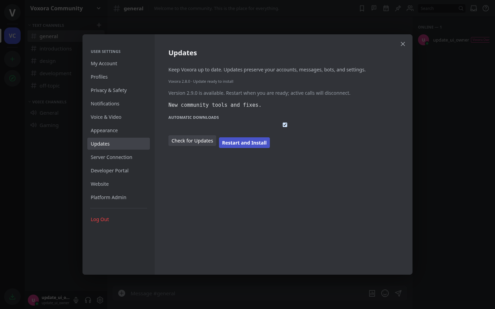

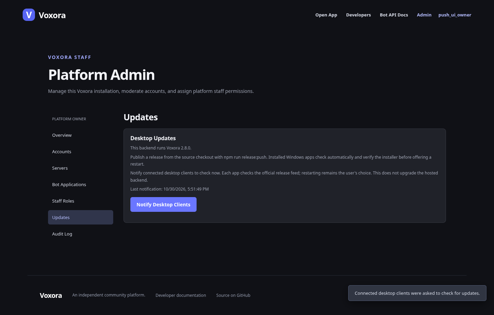

## What works

- Discord-style server rail, channel groups, member sidebar, friends/DM navigation, message grouping and dark theme.
- Account registration/login, salted scrypt passwords, HttpOnly sessions, profiles, custom statuses, online/idle/do-not-disturb/invisible presence, and logout.
- Multiple servers, invite links, join/leave, owner controls, text and voice channels, channel categories, and editable names/topics.
- Live messages, typing indicators, replies, edits, deletion, emoji reactions, pins, search, older-message pagination, Markdown, mentions, and per-account drafts.
- Image previews and downloadable attachments (up to 8 MB each; five per message), with channel access checks.
- Friend requests, accepting/ignoring/cancelling requests, friend lists, private DMs, blocking/unblocking, and member profile popups.
- Actual WebRTC microphone audio and camera video, mute, deafen, input-device selection, output volume, and screen capture through the browser/desktop picker.
- User settings, dark/light appearance, compact messages, font size, keyboard shortcuts, a quick switcher, and responsive navigation.

## Personal server folders and settings

Right-click a server icon to create a colored folder or move the server into one. Drag icons to organize them, or use **User Settings → Server Organization** for move controls. Folders sync across your devices, aggregate unread/mention badges, and can be marked read together. Deleting a folder keeps its servers.

Theme, compact display, font size and reduced-motion preference now sync with your account. **User Settings → Settings Backup** exports a JSON file and previews Merge/Replace imports, skipping unavailable servers and protecting newer changes on another device. Voice-device choices, messages and credentials stay out of exports. See [privacy, migration and API](docs/PERSONAL-SETTINGS.md).

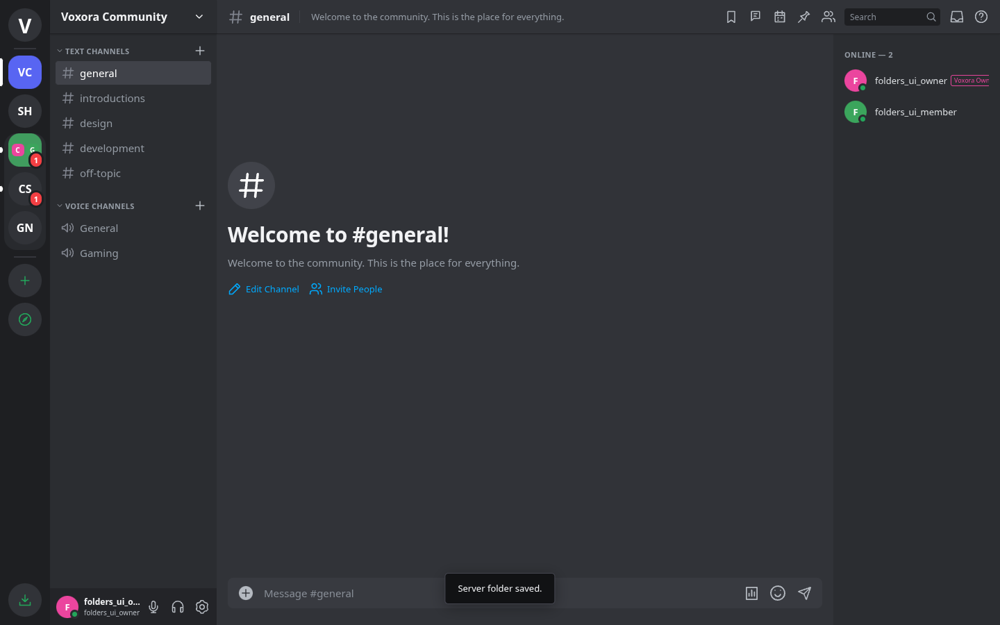

## AutoMod, reports and moderation queue

Configure **Server Settings → AutoMod** to block or flag literal phrases, link domains, excessive mentions, message floods and repeated messages. Preview rules before enabling them, and choose trusted-role/channel exemptions. AutoMod starts disabled.

Members can report server messages and thread replies, then track their own status in **Server dropdown → Your Reports**. Staff with **Review Reports** can claim cases, capture private notes, search/filter the queue and review a seven-day channel activity dashboard. Evidence survives source edits/deletion. Deleting sources, timing out, kicking or banning still requires the corresponding permission and hierarchy. Hidden channels and reporter details remain private. See [permissions, retention and API](docs/MODERATION.md).

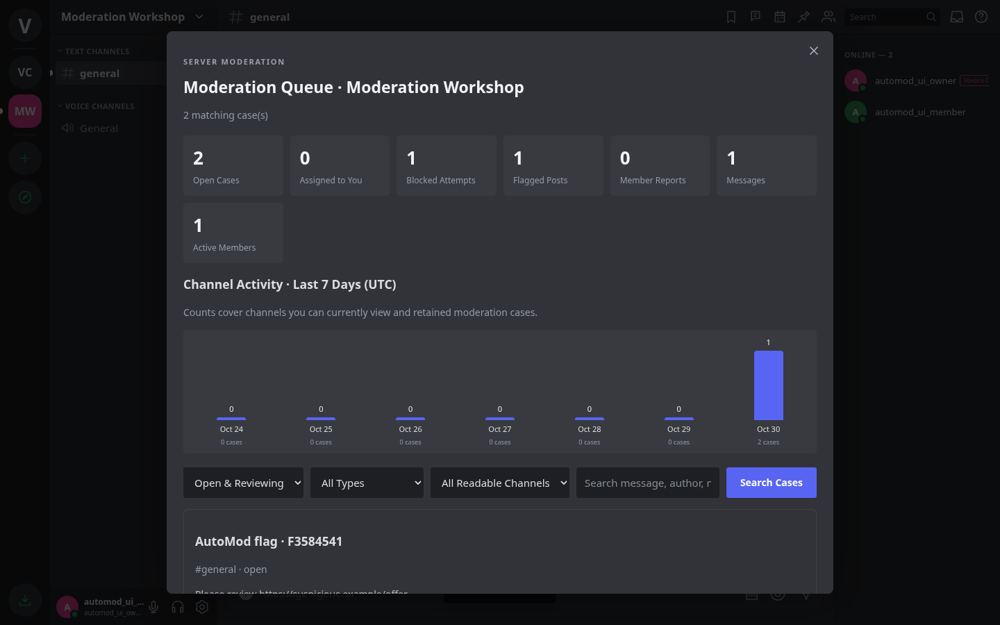

## Roles and server management

Open the server dropdown → **Server Settings**:

- **Overview:** edit the server name, color, and description.
- **Bots & Apps:** install Voxora Helper or custom bots, pause them, restrict channels, and manage their server roles.
- **Channels:** create and organize categories and channels, drag to reorder, use move buttons, and sync category permissions.
- **Emoji:** upload, rename, and delete custom server emoji with Manage Emoji.
- **Roles:** create colored roles, set permissions, display role members separately, reorder the hierarchy, and edit or delete roles.
- **Members:** assign roles, timeout members, kick, or ban, with moderation reasons.
- **Invites:** create links with expiration and maximum uses, copy them, and revoke access.
- **Bans:** review bans and revoke them.
- **Audit Log:** search the most recent 500 management actions, including actors, targets, timestamps, and reasons.
- **Transfer Ownership:** owner-only, requiring the server name as confirmation. Server deletion is also owner-only.

Right-click a member for role assignment and moderation. Right-click a channel → **Channel Permissions** to set role/member overrides. Existing servers automatically gain an editable `@everyone` role with their previous default access; member data and messages are preserved.

Permissions combine all assigned roles. Channel overrides apply in this order: `@everyone`, combined role denies then allows, and finally member denies then allows. **Administrator** bypasses channel restrictions but does not bypass role hierarchy or owner protection. A role manager cannot grant permissions they lack or manage roles/members at or above their highest role. `@everyone` cannot be renamed, reordered, or deleted.

Timeouts last up to 28 days, expire automatically, and prevent posting, reactions, uploads, and voice participation. Administrators and the owner cannot be timed out. Kicks allow rejoining with an invite; bans prevent rejoining until revoked. Leaving, kicking, or banning clears that member's role assignments and channel overrides. Changing voice permissions disconnects active calls so the new policy applies; members without Speak can join as listen-only without opening a microphone.

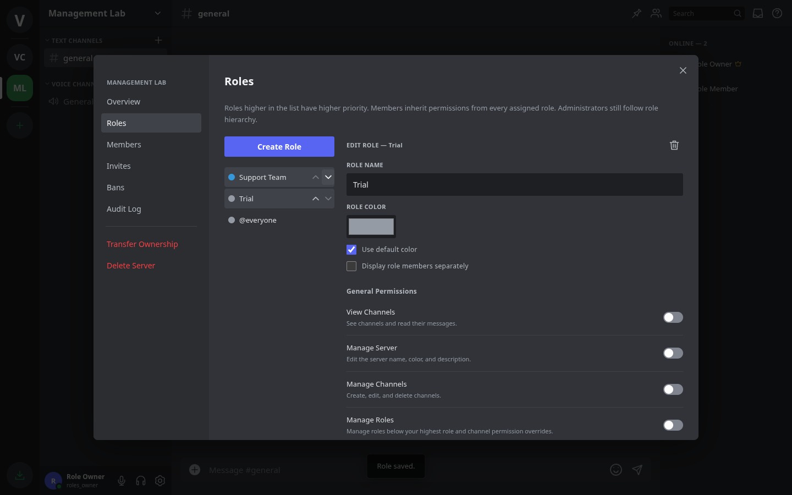

## Categories, private channels, and slowmode

Open **Server Settings → Channels** to create, rename, reorder, and remove categories. Drag a channel onto another channel to place it before that channel, or onto a category heading to move it into that category. Move buttons and a destination picker provide the same controls without dragging. The sidebar also supports dragging and right-click actions.

New channels inside a category inherit its permission overrides. **Category Permissions** changes apply immediately to synced channels, including disconnecting voice participants who lose access. Editing a channel's overrides makes that channel independent. Moving a channel keeps its existing permissions; **Sync Permissions** explicitly replaces them with the destination category's overrides and follows future changes. Syncing and editing overrides require Manage Roles and respect hierarchy and permission-grant checks. Deleting a category keeps its channels, messages, and effective permissions under **No category**. Existing channels migrate without changing their access.

Enable **Private Channel** during creation to hide it from everyone except the creator, owner, administrators, and members explicitly granted access. Creation requires Manage Channels and Manage Roles. Use **Channel Permissions** to grant roles or individual members access. Moving a private channel preserves its restrictions.

Text channels have a **Slowmode (seconds)** setting from 0 (off) to 21,600 (six hours). Members see a countdown while they wait and can keep writing their next message. Cooldowns are enforced by the backend across simultaneous requests, multiple clients, refreshes, and server restarts. Deleting a message does not reset its cooldown. Members with Manage Messages in the channel, or Manage Channels on the server, are exempt. Slowmode does not prevent editing an existing message.

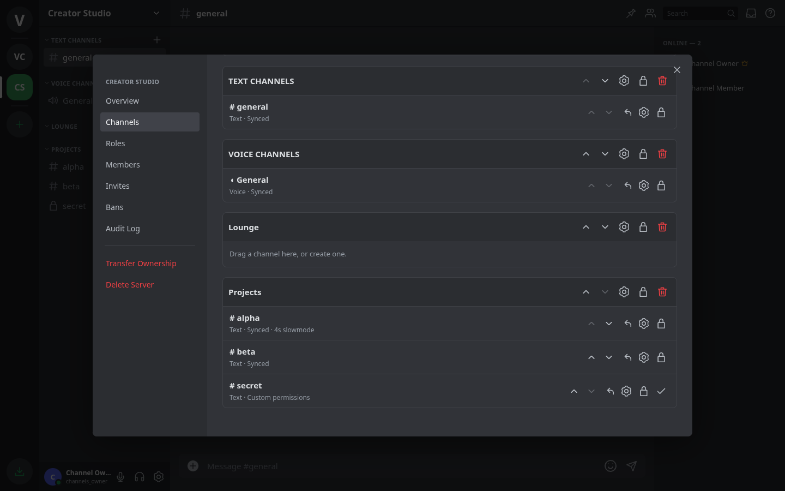

## Unread messages, Inbox, and notifications

Read positions now follow your account across reloads, sign-ins, and devices connected to the same backend. Server dots show unread conversations; red badges count personal mentions and replies, or unread DMs. A focused, visible conversation acknowledges messages as they enter its viewport. Background windows and open settings dialogs do not consume unread messages.

Open **Inbox** from the header, including on the Friends screen and mobile. **Mentions & DMs** shows unread personal mentions, replies to your messages, and new direct messages. **Unread** groups unread conversations and keeps muted ones available. Cards can jump to messages outside the latest 200; use **Load newer messages** or **Jump to Present** to return. Inbox rechecks channel access, excludes blocked DM participants, and drops messages from channels you can no longer view.

Right-click a text channel, DM, or message to **Mark as Read**, **Mark Unread**, or **Mark Unread from Here**. The server menu has **Mark Server as Read**, and Inbox has **Mark All Read**. Explicit unread markers pause automatic acknowledgement until you revisit the conversation or mark it read. Read versions prevent an older in-flight request from undoing a newer unread marker on another device. Mark-all uses the displayed snapshot's message watermark, so messages arriving afterward remain unread.

**User Settings → Notifications** enables optional desktop alerts and message sounds on this device. Message previews are off by default; enable them to include the sender and text in alerts. Desktop alerts require browser/system permission, respect **Do Not Disturb**, and run only while Voxora is open. Delivery through Windows notification services has not been validated; browser scenarios test the notification API boundary and inactive-window signals with controlled doubles.

Right-click a server or text channel → **Notification Settings** to choose all messages, personal mentions/replies, or nothing, with channel overrides and timed or indefinite muting. DMs support their own mute and alert controls. Server/channel settings sync with your account. Alerts pause while notification settings are saving, so an in-flight mute request suppresses new alerts immediately. Muting suppresses alerts and badges without discarding unread history; a channel override does not bypass a server mute. Mention matching handles username boundaries, case, and inline/fenced code rather than treating every substring as a ping. Mass and role mention notifications are not implemented.

Upgrading from 2.2 treats existing history as read, because older versions did not store durable read positions. New activity is tracked immediately. Joining a server starts at the current history; existing messages remain searchable.

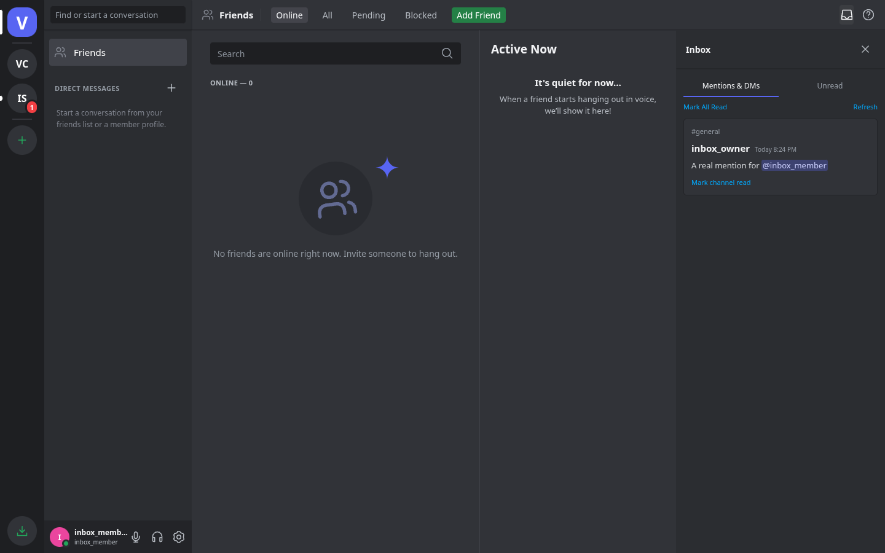

## Website, developer portal, and platform staff

The backend now includes a public homepage at `/`, the chat app at `/app`, the **Developer Portal** at `/developers`, bot documentation at `/developers/docs`, and **Platform Admin** at `/admin`. These share your account session. User Settings links to the website, developer portal, and admin tools when you have access. The Windows app opens `/app` directly and can still connect to older backends that use `/` for chat.

**The first registered human account owns the platform.** Existing installations assign this to the earliest human account; bots are excluded. Create that account before opening a new backend to the public. Platform ownership is separate from server ownership and does not follow a server transfer.

The owner creates custom Voxora staff roles in **Platform Admin → Staff Roles**, then assigns them in **Accounts → Assign Staff Roles**. Permissions combine across roles and cover account suspensions/restoration, server moderation, bot application moderation, and platform audit logs. Only the owner assigns staff roles. Regular staff cannot suspend the owner, themselves, or other staff. Staff badges appear in the app. Platform staff tools do not bypass channel privacy or expose DM contents or bot tokens.

Suspension ends human sessions and voice connections and pauses applications owned by that user. Staff can disable abusive bot applications without deleting their messages or installations. Moderation actions require a reason and are recorded in the platform audit log; removing a server also requires entering its name. See [platform administration](docs/PLATFORM.md).

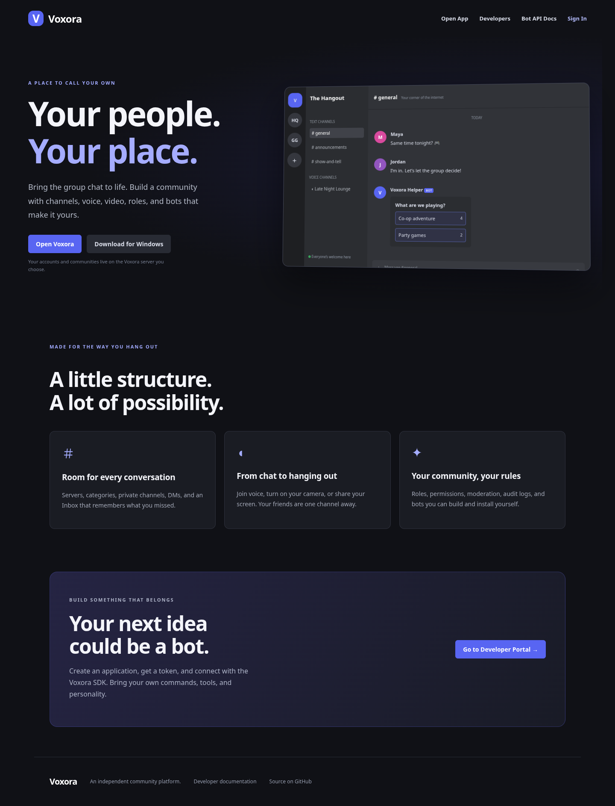

## Make and install bots

Open **Developer Portal → New Application** to create a bot and receive its one-time token. Install it in a server you manage, download **Bot Starter**, and extract it. With Node.js 22+ installed, double-click **`start-bot.bat`** in its folder on Windows. The first launch opens `.env` for your server URL and token; save it and launch again. The starter includes a dependency-free JavaScript SDK, an environment template, and 25 moderation, economy, and utility commands, plus `!ping`. This community template requires Voxora 2.5 or later. See the [complete bot API and SDK guide](docs/BOTS.md).

Bot support includes registered slash commands, a command picker, REST text/poll messages, replies, reactions, message editing/deletion, and a live SSE gateway. Tokens are stored hashed; rotation and revocation stop old credentials and connections immediately. Bot access follows server roles, channel overrides, and an additional per-installation channel restriction. Bots cannot become server owners or platform staff, use human sessions, or access DMs. Custom bot code runs in your own process and must connect to the same backend as the community. This API is independent of Discord's API and discord.js.

For a bot that needs no external process, install **Voxora Helper** in **Server Settings → Bots & Apps**. It supplies `/help`, `/ping`, `/roll NdM`, `/server`, and `/poll Question | Choice 1 | Choice 2`. Its installation can be paused, scoped to selected channels, or removed. Commands and arguments are visible in their channel. Custom command responses are accepted once within 15 minutes and are reauthorized at response time. The SDK reconnects and recovers pending commands; message events have no replay log, so use REST history to backfill missed messages.

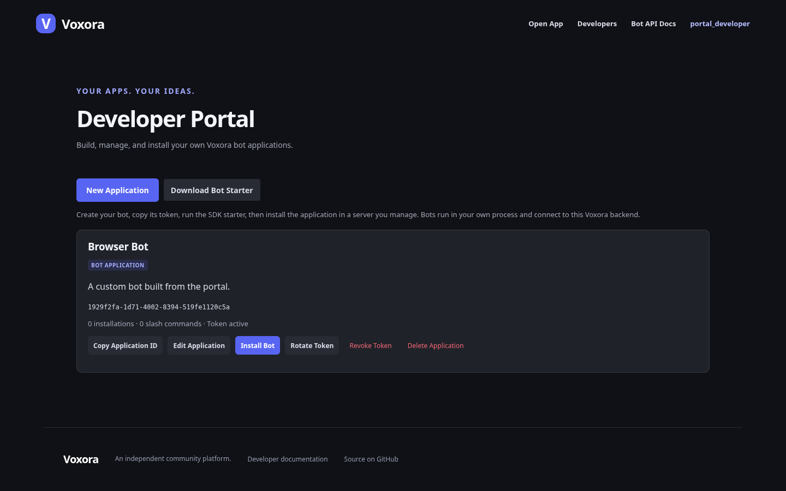

## Polls

Use **Create Poll** beside the composer, or ask Voxora Helper with `/poll`. Polls support 2–10 distinct answers, single or multiple selections, vote changes and withdrawal, live results, and durations from 1 hour to 7 days. Add Reactions is required to vote. Creators and message moderators can end polls; questions and answers cannot be edited after posting. Votes and closure persist across restarts. Bot-created command polls can also be ended by the person who invoked the command.

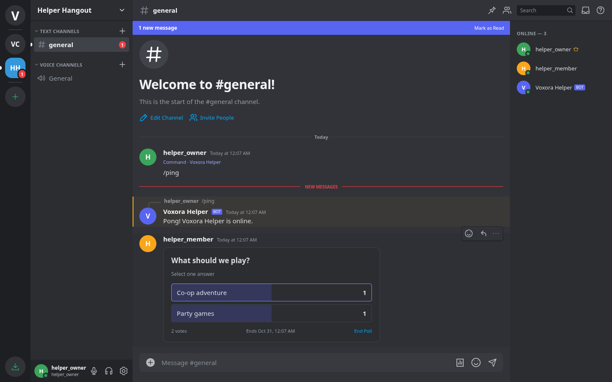

## Community bot template

The downloadable starter now registers **25 slash commands**. Use `/bothelp moderation`, `/bothelp economy`, or `/bothelp utility` for usage.

- **Moderation:** `/warn`, `/warnings`, `/clearwarns`, `/timeout`, `/untimeout`, `/kick`, `/ban`, `/unban`, and `/purge`.
- **Economy:** `/balance`, `/daily`, `/work`, `/pay`, `/leaderboard`, `/shop`, `/buy`, and `/inventory`.
- **Utilities:** `/bothelp`, `/echo`, `/roll`, `/choose`, `/eightball`, `/serverinfo`, `/userinfo`, and `/poll`; the text `!ping` still works.

Give the bot a server role with the moderation permissions it needs and place that role above members it should moderate. The backend checks **both the command user's and the bot's current permissions and role hierarchy**. Neither can moderate the owner or bypass hierarchy. Warning records persist in the backend and remain outside ordinary bootstrap data. Cleanup removes up to 50 unpinned messages. Actions are audited with the bot and the human requester; replayed commands cannot repeat an action.

Economy credits, daily/work cooldowns, payments, collectible purchases, inventories, and command receipts persist in the bot's **`bot-data/` folder**, separately for each application and server. Preserve that folder and your `.env` when updating the starter. Collectibles are cosmetic bot inventory items, not server roles. Run one process per bot data file. The file lock prevents a second running instance from overwriting balances. See the [bot guide](docs/BOTS.md) for cooldowns and data backup instructions.

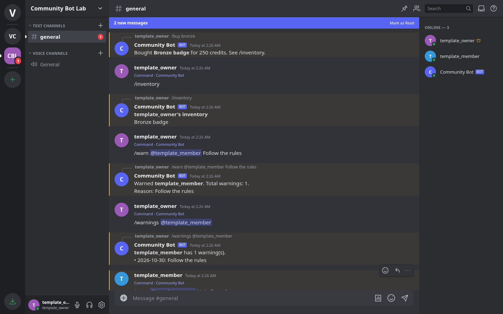

## Announcement channels and following

Choose **Announcement** when creating a channel, or enable **Announcement Channel** while editing a text channel. Open the announcement channel and choose **Follow** to select a text channel in another server where you have Manage Channels and Send Messages.

Posting alone keeps a message in its source channel. Use the post's **Publish Announcement** button, or its right-click menu, to send a copy to current followers. Your own posts require Send Messages; publishing someone else's requires Manage Messages. Published posts and attachments arrive in followers' chosen channels with their source label. Each message publishes once. Copies keep the published version; later edits or deletion in the source do not change those copies. Polls, command invocations, and received announcements cannot be published.

Right-click a destination channel → **Following** to review subscriptions or unfollow. Future delivery pauses if the person who created the follow loses source access, destination management/posting permissions, or is suspended. Both servers must be on the **same Voxora backend**; federation between separate installations is not implemented. See [announcement delivery](docs/ANNOUNCEMENTS.md).

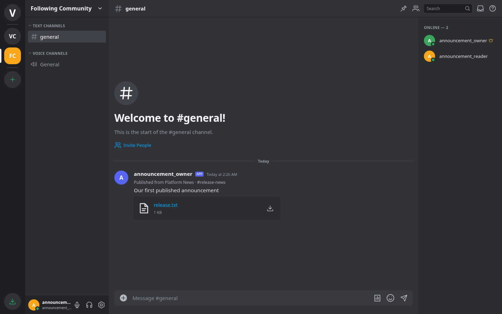

## Discovery, templates, and events

- **Discover Servers:** the compass in the server rail opens searchable communities, filtered by category. Existing servers stay unlisted. Use **Server Settings → Discovery** to opt in with a public summary and tags. Discovery joining respects bans and private channels.
- **Server Templates:** **Add a Server → Use a Template** offers Community, Gaming, Study Group, and Creator presets, including private staff rooms. Server owners can use **Create Server Template** to share a frozen layout by code and revoke it in My Templates. Templates copy layout, topics and role permissions into a new server with fresh IDs; members, messages, tokens, follows and other runtime data are excluded.
- **Scheduled Events:** open **Events** from the server menu or calendar button. Members with **Manage Events** can schedule voice or external events, edit them, and manage their lifecycle. Members can RSVP and download calendar files. Private voice events remain hidden without channel access. Event updates and RSVPs sync to other open lists.

These communities share the Voxora backend you connect to; separate local installations need a shared backend to find each other. Preserve your data directory during upgrades. See [community features and API](docs/COMMUNITIES.md) for privacy, template contents, calendar behavior and setup.

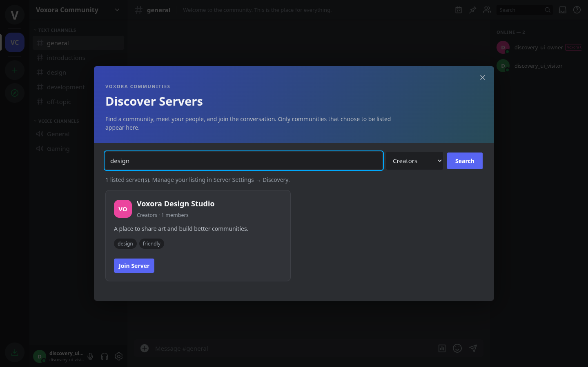

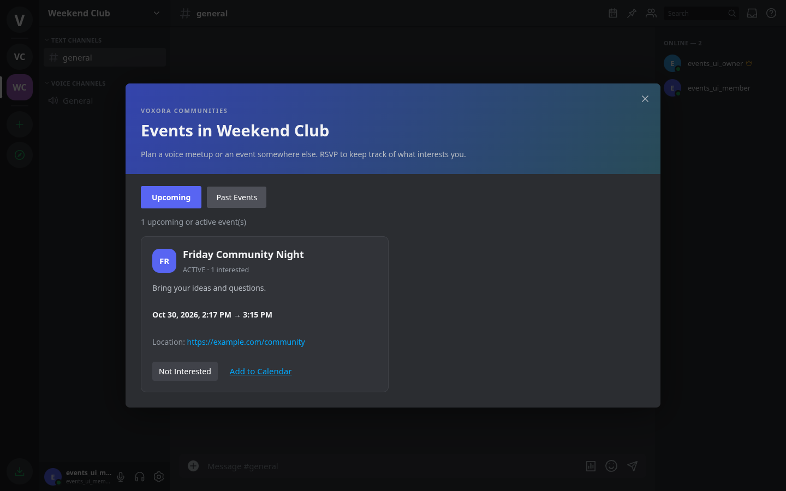

## Threads, saved messages, and custom emoji

- **Threads:** right-click a channel message → **Create Thread**, or use **Channel Threads** in the header. Replies appear beside the channel with live updates, attachments, edits, reactions, and separate unread counts. Creators can archive and reopen; **Manage Threads** adds locking and deletion. Threads inherit channel access and slowmode, and archive after 24 hours without replies.
- **Saved Messages:** right-click a message → **Save Message**, or save a thread reply. Open the bookmark button in the header to search your saves, add private notes, and jump back to the original. Saves follow your account across restarts; inaccessible, blocked, or deleted content is hidden.
- **Custom emoji:** **Server Settings → Emoji** accepts PNG, GIF, and WebP images up to 256 × 256 pixels and 256 KB each. Use the emoji picker in messages, thread replies, and reactions. Published announcements preserve copies of their custom emoji in following channels.
- **Bots:** the updated SDK supports creating threads, reading and sending replies, editing, reactions, and live thread events. Installation channel restrictions apply to threads too.

New servers let members create threads by default. On existing servers, explicitly grant **Create Threads** to the desired roles; owners and administrators already have access. Custom emoji require Voxora 2.7 on the shared backend. See [conversation features and API](docs/CONVERSATIONS.md) for permissions, limits, and privacy behavior.

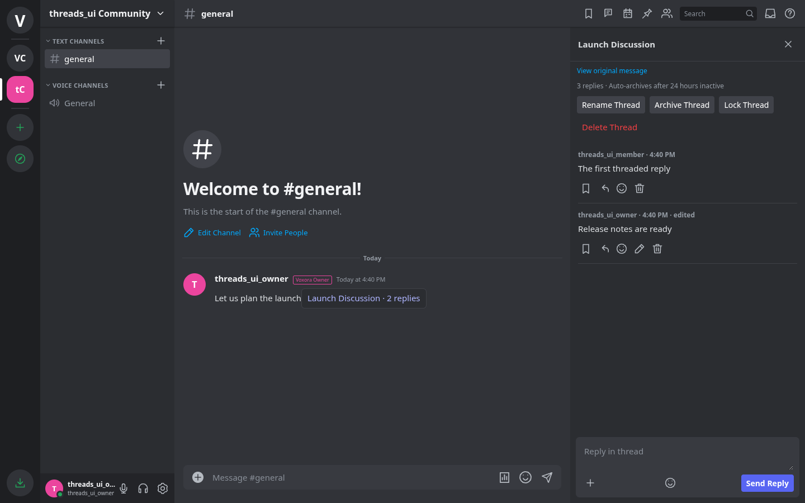

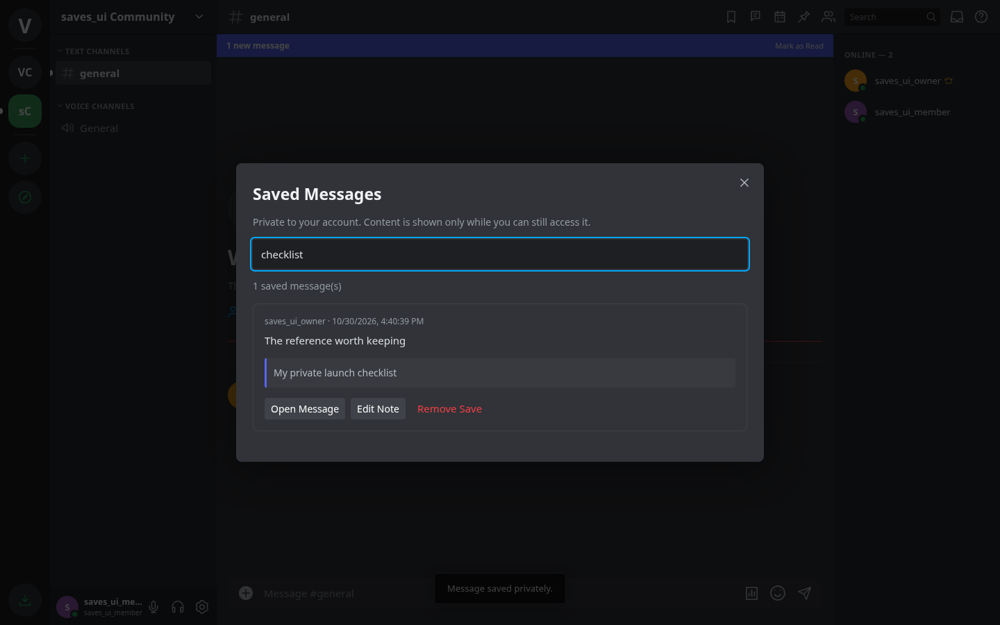

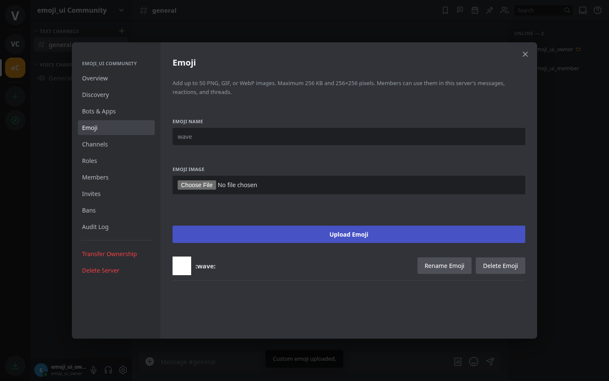

## Welcome guides, rules, and optional roles

Open **Server Settings → Onboarding** to build a welcome guide with a title, introduction, up to ten rules, and five recommended channels. **Require new members to accept rules** keeps new arrivals from posting, reacting, uploading, creating threads, or joining calls until they accept. Existing members keep their access when you enable this. Pending members must accept the current rules if you edit them while their guide is open.

Members with **Manage Roles** can offer up to twelve optional interest, color, or channel-access roles. Members choose them in **Server Guide**, available from the server menu or channel welcome area. Choices persist across devices and can unlock private channels. Recommendations always follow current channel privacy, including while the guide is open.

Self-selected roles do not increase moderation rank. Staff permissions and management overrides cannot be offered; changing an offered role to grant them withdraws self-granted assignments before the change becomes active. Explicit staff assignments are preserved. See [onboarding permissions, privacy, and API](docs/ONBOARDING.md).

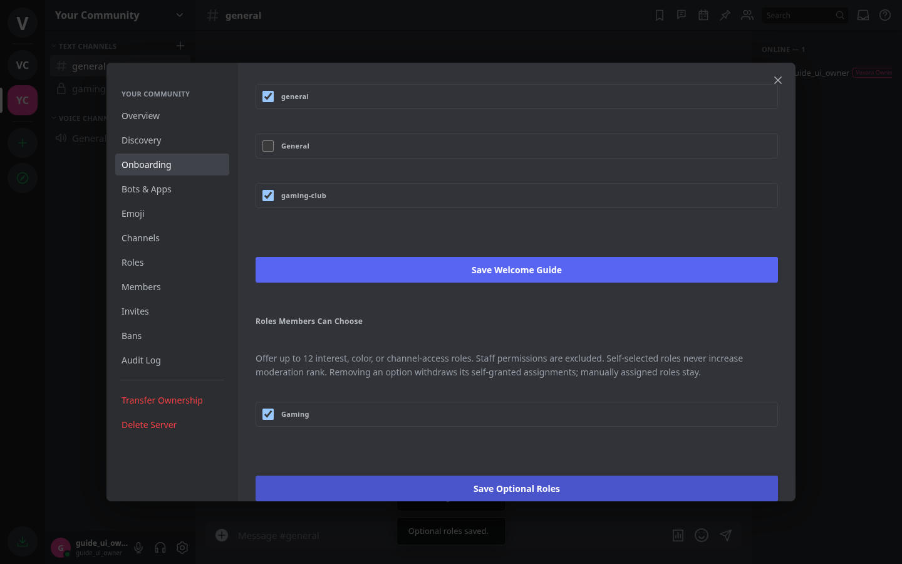

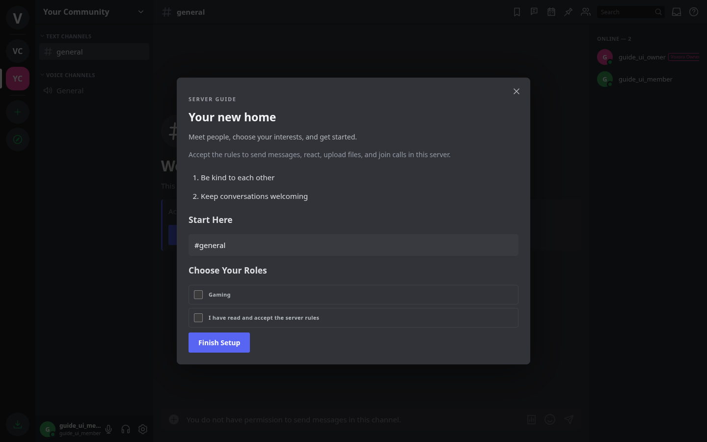

## Talk to people on other computers

**Separate desktop installations initially run separate local servers.** To share accounts, messages, and calls, host one Voxora backend and connect each desktop client to that same address in **User Settings → Server Connection** (also available on the login screen).

The local desktop server binds to `127.0.0.1:43127`. Desktop data lives in `%APPDATA%\Voxora\chat-data`; updates and uninstall preserve it. The browser profile also retains your session and preferences. Voxora 1.x `messages.json` data migrates automatically into `state.json` on first startup without deleting the original file.

For a shared instance, run the web server behind an HTTPS reverse proxy with a persistent data directory. For example, on a server with Node.js 20+:

```sh
PORT=3000 VOXORA_HOST=127.0.0.1 VOXORA_DATA_DIR=/path/to/persistent/voxora node server.js
```

A Caddy configuration can expose that listener (replace the example domain with your own):

```caddyfile
chat.example.com {
    reverse_proxy 127.0.0.1:3000 {
        flush_interval -1
    }
}
```

Preserve the public Host header and proxy HTTPS information; SSE connections must remain open and unbuffered. Use a process manager to restart the Node service. Back up the whole data directory, including `state.json`, `uploads/`, and `emojis/`. No hosted backend has been deployed by this repository.

Voice and video use WebRTC. The default ICE configuration uses Google's public STUN service. For restrictive NATs, configure your own TURN service with `VOXORA_ICE_SERVERS`, a JSON array of WebRTC ICE server objects. Enter credentials securely through your hosting environment; do not commit them. HTTPS or localhost is required for microphone/camera/screen access. Screen sharing does not include system audio.

## Development

Node.js 22+ is recommended for the development and desktop toolchain.

```sh
npm ci
npm run check
npm test
npm start
```

The website and app run on port 3000 by default; open `/app` for chat. Its dependencies are Node built-ins. `PORT`, `VOXORA_HOST`, `VOXORA_DATA_DIR`, and `VOXORA_ICE_SERVERS` configure the backend. `.data/` is ignored by Git. Local accounts and runtime secrets are not included in the source ZIP or installer.

### Browser tests

```sh
npx playwright install chromium
npm run test:ui
```

The thirty-two browser scenarios exercise chat/message actions and uploads, two-user private servers/friends/DMs, a two-user WebRTC call carrying actual audio and video, narrow-screen navigation, role/channel management and moderation, listen-only voice with access revocation, category organization, privacy, inherited permissions and slowmode across reloads, persistent unread tracking and cross-device acknowledgement, notification modes and previews, navigation beyond the latest 200 messages, native poll voting, built-in bot installation and slash commands, custom bot creation/token issuance and SDK responses, the actual community bot process with economy and moderation, cross-server announcement following and attachment publishing, public discovery with private-channel protection, preset/shared layout templates, scheduled event RSVPs and calendar downloads, the public website with first-account ownership and staff moderation, live thread editing/deletion and locking, private saved notes with access revocation, custom emoji upload, messages, reactions, and renaming, desktop update controls with a controlled native bridge, owner-triggered update checks, welcome/rules/role setup, Discovery onboarding before any channel is visible, live AutoMod configuration/preview/blocking, case claims/private notes/resolution, member reports and receipts, source deletion, thread report navigation, live reviewer access revocation, private folder organization and unread badges, cross-device appearance, settings import/export with previews, stale forms, and rapid appearance changes over a delayed connection. Test media devices are synthetic. The 41-test backend suite checks authentication, authorization, friend/block rules, attachments, migration, pagination, persistence after restart, role hierarchy and privilege escalation checks, delayed-request permission revocation, channel overrides, bans, invite limits, and ownership transfer, category migration/inheritance, private channels, ordering, persistent slowmode under concurrent requests, private inbox filtering, exact mention matching, read-state migration, stale-device protection persistent notification settings, thread pagination/reads and SDK gateway events, private saved-message references, custom emoji scopes and delayed upload revocation, copied announcement emoji assets, update feed validation, interrupted/corrupted downloads, persistent update preferences, cached update verification, owner-only update broadcasts, rules gating and version checks, role-menu hierarchy safety, automatic withdrawal of unsafe grants, private onboarding progress, Unicode/literal/domain filters, poll/edit/thread filtering, durable spam windows under concurrent requests, report deduplication and limits, private evidence, conflict protection, channel-filtered analytics, real case enforcement, queue capacity, moderation event privacy, private workspace migration and persistence, strict settings validation, safe merge/replace imports, version conflicts, delayed membership/suspension revocation and account-only workspace events. Tests use isolated temporary data directories.

For a compatible existing Chromium binary, set `VOXORA_BROWSER_PATH`. This cloud environment uses the npm-distributed `@sparticuz/chromium` binary because the Playwright CDN is unavailable; `VOXORA_BROWSER_MODULE` can point to its `build/index.js` for the corresponding launch arguments.

### Bot starter kit

`npm run build:bot-starter` refreshes the downloadable starter from the SDK, example, and bot documentation. The normal Windows build runs this step automatically. The starter contains no account data or tokens.

### Desktop development and builds

```sh
npm run desktop
npm run dist:win
```

The x64 NSIS installer is created at `dist/Voxora-Setup-2.11.0.exe`. A custom NSIS script builds without Wine, includes shortcuts and an uninstaller, and only removes the exact application files it installed. It preserves chat data and unrelated files. The Electron renderer has Node integration disabled, context isolation and sandboxing enabled, restricted navigation, and media permissions limited to the selected Voxora server.

On restricted cloud machines, use writable caches:

```sh
XDG_CACHE_HOME=/workspace/.cache npm ci --cache /workspace/.cache/npm
XDG_CACHE_HOME=/workspace/.cache ELECTRON_BUILDER_CACHE=/workspace/.cache/electron-builder npm run dist:win
```

## Validation and current limits

All twenty-nine backend tests across fourteen scenario files and all twenty-five Chromium browser scenarios pass, including a live two-user WebRTC connection with received audio packets and camera video. The Windows installer is cross-built on Linux and its embedded files are integrity-checked; Windows installation/launch and desktop screen capture still need Windows validation. No code-signing certificate is configured.

Voxora implements these core workflows; it does not provide Discord's hosted network, Discord interoperability, Nitro, Discord bot API compatibility, a media SFU, notifications while the app is closed, email recovery, or large-scale production operations. Role permissions and hierarchy control moderation in this version. Internet calls across every network require correctly configured TURN infrastructure. Before operating a public service, review deployment security, capacity, moderation and backups.
