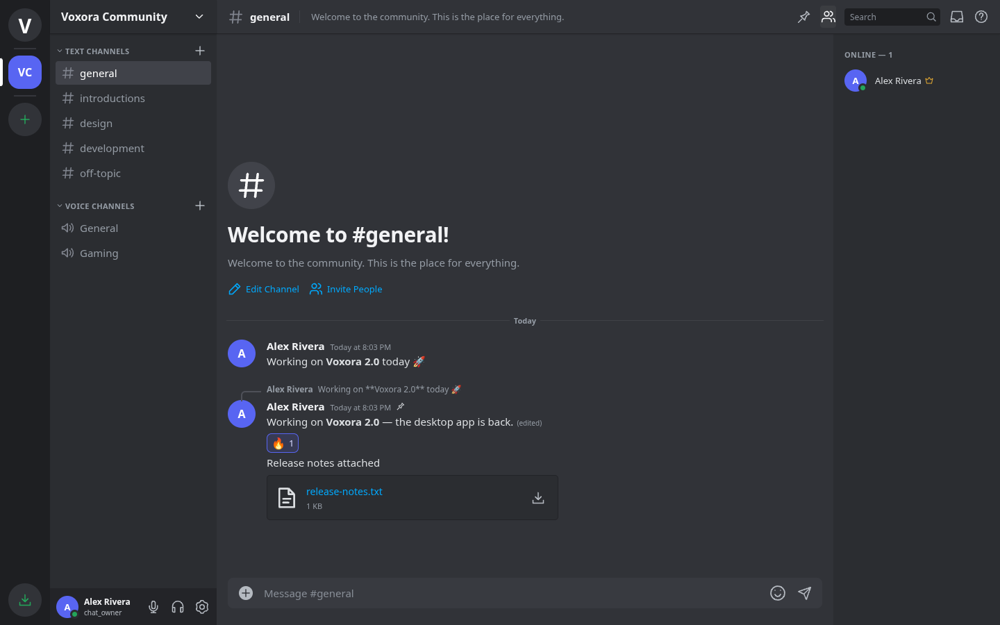

# Voxora 2.0

A Discord-style desktop and web application with real accounts, servers, private conversations, and peer-to-peer voice/video.

## Install on Windows

**[Download Voxora Setup 2.0.0](https://github.com/Whoops-Lambo/Voxora/raw/refs/heads/main/installers/Voxora-Setup-2.0.0.exe)**

Close an older running copy of Voxora, run the installer, and launch Voxora from the desktop or Start menu. The installer bundles its runtime; **Node.js is not required**. Requires **64-bit Windows 10 or later**. It is unsigned, so Windows may show an unknown-publisher warning. SHA-256 checksums are in [installers/SHA256SUMS.txt](installers/SHA256SUMS.txt). Installers are stored with Git LFS: use **Download raw file** on GitHub, or `git lfs pull` when cloning.

Register an account on the login screen. The first account owns the default community. Create a private server using the **+** on the server rail, invite another account, and start chatting. Accounts belong to the Voxora server you connect to; they are independent of Discord accounts.



## What works

- Discord-style server rail, channel groups, member sidebar, friends/DM navigation, message grouping and dark theme.
- Account registration/login, salted scrypt passwords, HttpOnly sessions, profiles, custom statuses, online/idle/do-not-disturb/invisible presence, and logout.
- Multiple servers, invite links, join/leave, owner controls, text and voice channels, channel categories, and editable names/topics.
- Live messages, typing indicators, replies, edits, deletion, emoji reactions, pins, search, older-message pagination, Markdown, mentions, and per-account drafts.
- Image previews and downloadable attachments (up to 8 MB each; five per message), with channel access checks.
- Friend requests, accepting/ignoring/cancelling requests, friend lists, private DMs, blocking/unblocking, and member profile popups.
- Actual WebRTC microphone audio and camera video, mute, deafen, input-device selection, output volume, and screen capture through the browser/desktop picker.
- User settings, dark/light appearance, compact messages, font size, keyboard shortcuts, a quick switcher, and responsive navigation.

## Talk to people on other computers

**Separate desktop installations initially run separate local servers.** To share accounts, messages, and calls, host one Voxora backend and connect each desktop client to that same address in **User Settings → Server Connection** (also available on the login screen).

The local desktop server binds to `127.0.0.1:43127`. Desktop data lives in `%APPDATA%\Voxora\chat-data`; updates and uninstall preserve it. The browser profile also retains your session and preferences. Voxora 1.x `messages.json` data migrates automatically into `state.json` on first startup without deleting the original file.

For a shared instance, run the web server behind an HTTPS reverse proxy with a persistent data directory. For example, on a server with Node.js 20+:

```sh
PORT=3000 VOXORA_HOST=127.0.0.1 VOXORA_DATA_DIR=/path/to/persistent/voxora node server.js
```

A Caddy configuration can expose that listener (replace the example domain with your own):

```caddyfile
chat.example.com {
    reverse_proxy 127.0.0.1:3000 {
        flush_interval -1
    }
}
```

Preserve the public Host header and proxy HTTPS information; SSE connections must remain open and unbuffered. Use a process manager to restart the Node service. Back up the whole data directory, including `state.json` and `uploads/`. No hosted backend has been deployed by this repository.

Voice and video use WebRTC. The default ICE configuration uses Google's public STUN service. For restrictive NATs, configure your own TURN service with `VOXORA_ICE_SERVERS`, a JSON array of WebRTC ICE server objects. Enter credentials securely through your hosting environment; do not commit them. HTTPS or localhost is required for microphone/camera/screen access. Screen sharing does not include system audio.

## Development

Node.js 22+ is recommended for the development and desktop toolchain.

```sh
npm ci
npm run check
npm test
npm start
```

The web app runs on port 3000 by default. Its dependencies are Node built-ins. `PORT`, `VOXORA_HOST`, `VOXORA_DATA_DIR`, and `VOXORA_ICE_SERVERS` configure the backend. `.data/` is ignored by Git. Local accounts and runtime secrets are not included in the source ZIP or installer.

### Browser tests

```sh
npx playwright install chromium
npm run test:ui
```

The four browser scenarios exercise chat/message actions and uploads, two-user private servers/friends/DMs, a two-user WebRTC call carrying actual audio and video, and narrow-screen navigation. Test media devices are synthetic. The backend suite checks authentication, authorization, friend/block rules, attachments, migration, pagination, and persistence after restart. Tests use isolated temporary data directories.

For a compatible existing Chromium binary, set `VOXORA_BROWSER_PATH`. This cloud environment uses the npm-distributed `@sparticuz/chromium` binary because the Playwright CDN is unavailable; `VOXORA_BROWSER_MODULE` can point to its `build/index.js` for the corresponding launch arguments.

### Desktop development and builds

```sh
npm run desktop
npm run dist:win
```

The x64 NSIS installer is created at `dist/Voxora-Setup-2.0.0.exe`. A custom NSIS script builds without Wine, includes shortcuts and an uninstaller, and only removes the exact application files it installed. It preserves chat data and unrelated files. The Electron renderer has Node integration disabled, context isolation and sandboxing enabled, restricted navigation, and media permissions limited to the selected Voxora server.

On restricted cloud machines, use writable caches:

```sh
XDG_CACHE_HOME=/workspace/.cache npm ci --cache /workspace/.cache/npm
XDG_CACHE_HOME=/workspace/.cache ELECTRON_BUILDER_CACHE=/workspace/.cache/electron-builder npm run dist:win
```

## Validation and current limits

Backend tests and all four Chromium browser scenarios pass, including a live two-user WebRTC connection with received audio packets and camera video. The Windows installer is cross-built on Linux and its embedded files are integrity-checked; Windows installation/launch and desktop screen capture still need Windows validation. No code-signing certificate is configured.

Voxora implements these core workflows; it does not provide Discord's hosted network, Discord interoperability, Nitro, bots, custom permission roles, a media SFU, push notifications, email recovery, or large-scale production operations. Server ownership controls moderation in this version. Internet calls across every network require correctly configured TURN infrastructure. Before operating a public service, review deployment security, capacity, moderation and backups.
