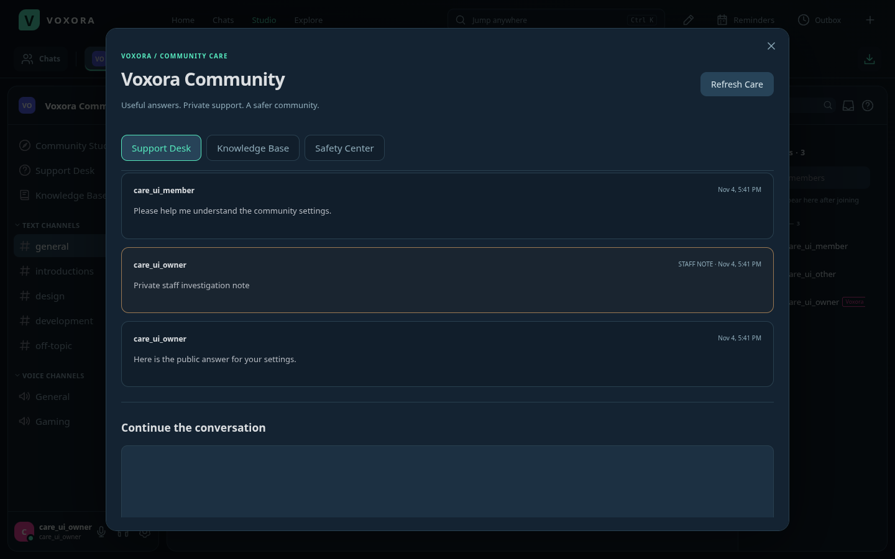
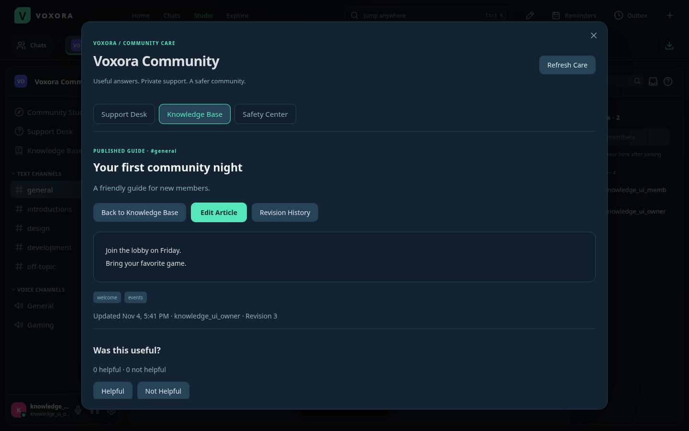
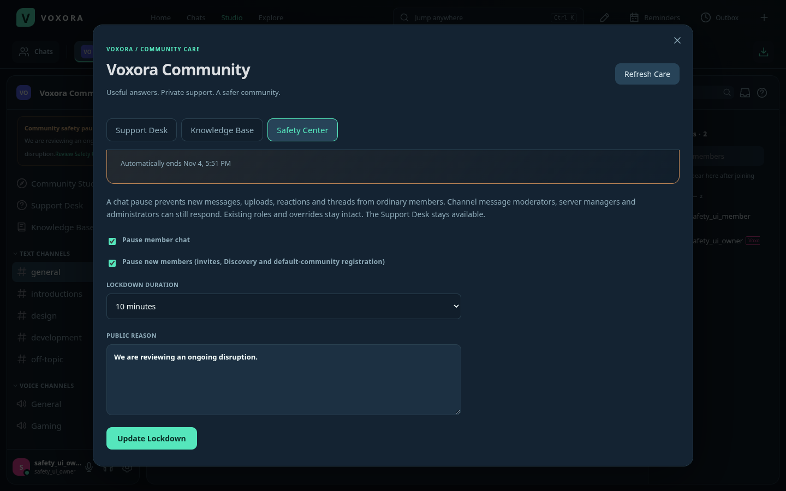

# Community Care

Voxora 3.2 adds a private Support Desk, a channel-aware Knowledge Base and a timed Safety Center. Open **Support Desk** or **Knowledge Base** from a server sidebar/menu, or from Community Studio. Your active tickets and pinned guides also appear in Home.

## Private Support Desk

Select **New Support Ticket**, choose a category, and describe your question. Only the requester and members with **Manage Support Tickets** or **Manage Server** can read it. Platform staff roles alone do not grant access. The requester must remain a member of the server. Server support staff can still review a departed member's history, labeled Former member.

- Members can open, reply to, resolve and reopen their own tickets. They never receive other members' ticket titles, contents or queue totals.
- Support staff can claim/release tickets, set Low/Normal/High/Urgent priority, answer publicly, add private staff notes, and archive/restore closed work.
- A public staff answer changes the ticket to Waiting; a requester reply returns it to Open. Private notes do not change this public activity state or appear in requester transcripts.
- The requester transcript contains public messages only. A staff transcript also includes staff notes, labeled clearly. Select **Download Transcript** for a text file.
- Replies typed in the editor survive incoming ticket updates. Revision checks protect competing edits; duplicate request identifiers prevent network retries from creating duplicate tickets/replies.
- Timed-out members and members who have not accepted required rules cannot open or reply to tickets. They retain read access to their existing public conversation.

Assign **Create Support Tickets** to allow new requests. It is enabled for the ordinary member role on upgrade and can be revoked afterward. **Manage Support Tickets** is a separate permission that grants access to all server tickets and private notes; assign it deliberately to your support team. **Support Settings** lets that team customize the introduction and up to eight categories.

Each person can have five active tickets and open five per hour. Replies are limited to 30 per minute per account, and a ticket holds up to 200 messages. A community can retain 2,000 tickets. Tickets persist in the backend's existing state file; no separate database is needed.

## Knowledge Base

Members can search published articles, filter by channel, read pinned guides and give Helpful/Not Helpful feedback. Articles inherit the visibility of a text channel. A guide in a private staff channel stays hidden from people who cannot view that channel, including Home cards and search results.

Members with **Manage Knowledge Base** or **Manage Server** can create drafts, edit guides, publish/unpublish them, and pin them in Knowledge Base and Home. They must also be able to view the chosen channel. Drafts are visible only to authorized knowledge managers; ordinary members and bots cannot read them.

The editor includes a live preview, a summary and up to six tags. Article text supports Voxora's existing bold, italic, code, spoiler and web-link formatting. It is rendered as text and safe DOM elements rather than accepted HTML. Editing the body clears old helpfulness feedback, so ratings describe the current answer.

**Revision History** keeps the ten most recent saved editions. **Restore Revision** creates a new edition from an older one, preserving the current edition in history. Current permissions are checked again before a restore; revision history from channels the manager cannot view is excluded.

Articles hold up to 12,000 characters, with 1,000 articles per community. Feedback is one vote per account and can be changed or cleared. Voter identities are excluded from the API's article views.

## Safety Center

Open **Server Settings → Safety Center → Open Safety Center**, or the Safety Center tab inside Community Care. **Manage Server Safety** or **Manage Server** is required. Choose:

- **Pause member chat:** stops ordinary members from sending/editing messages, uploading, adding reactions, voting in polls and creating threads. Channel message moderators, server managers and administrators can still respond. Existing voice sessions are unaffected.
- **Pause new members:** blocks regular/custom invite joins and Discovery joins. If the default Community is paused, newly registered accounts remain outside it until the pause ends and they join. Existing members can still use their invite link to reopen their server.
- **Duration:** 10 minutes, one hour, 24 hours, or until manually stopped. The API accepts an end time up to 30 days away.

A public reason is required and shown to members in the sidebar. Invite previews indicate when new members are paused. The Support Desk remains available during a chat pause, allowing members to ask for help.

The Safety Center records start/update/stop actions in the server audit log. It does not rewrite role permissions or channel overrides. Expiry restores normal access automatically, including across backend restarts. An interrupted pause can be stopped early with **Stop Lockdown**.

## Bots

The SDK adds `getKnowledgeArticles(serverId, {q, channel})` and `getKnowledgeArticle(serverId, articleId)`. Bots can read published articles only, through their enabled installation's channel scope and current channel permissions. They cannot read private support tickets, staff notes, drafts or article history.

The optional `start-studio-bot.bat` now registers `/knowledge [search]` alongside `/projects` and `/giveaways`. It needs a 3.2 backend. The ordinary moderation/economy starter and launchers remain available.

## API

All paths below begin with `/api/servers/:serverId/care` and require an authenticated server member. Mutations recheck current membership, suspension and permissions after reading their request bodies.

| Path | Purpose |
| --- | --- |
| `GET /` | Personalized support counts, settings and visible channels |
| `GET/POST /tickets` | List visible tickets or open a request with a nonce |
| `GET/PATCH /tickets/:id` | Read or update status, priority or claim with a revision |
| `POST /tickets/:id/reply` | Add a public reply or staff-only note with revision and nonce |
| `GET /tickets/:id/transcript` | Downloadable text and filename, filtered for the viewer |
| `GET/PATCH /settings` | Staff-managed support introduction and categories |
| `GET/POST /articles` | Search visible guides or create an article with a nonce |
| `GET/PATCH /articles/:id` | Read or edit a guide with a revision |
| `POST /articles/:id/feedback` | Set `helpful` to true, false or null, with a revision |
| `GET /articles/:id/history` | Authorized saved editions |
| `POST /articles/:id/restore` | Restore `restoreRevision` using the current `revision` |
| `GET/PATCH /safety` | Manage a revision-checked safety pause |

List endpoints return up to 25 items with `total`, `offset` and `hasMore`. Ticket filters include `q`, `status` and `assigned=me`. Article filters include `q`, `status`, `channel` and `tag`. Bot knowledge reads use the same article paths under `/api/bot/servers/:serverId/care/articles`, authenticated with the Bot header.

## Deployment

The Windows installer bundles these features for Local Workspace, and the official update feed offers Restart and Install. A separately hosted backend must also pull the new source, run `npm ci`, and restart while retaining its data directory. The public service still requires an always-running backend; this feature release does not provision hosting or invent a public server address.
