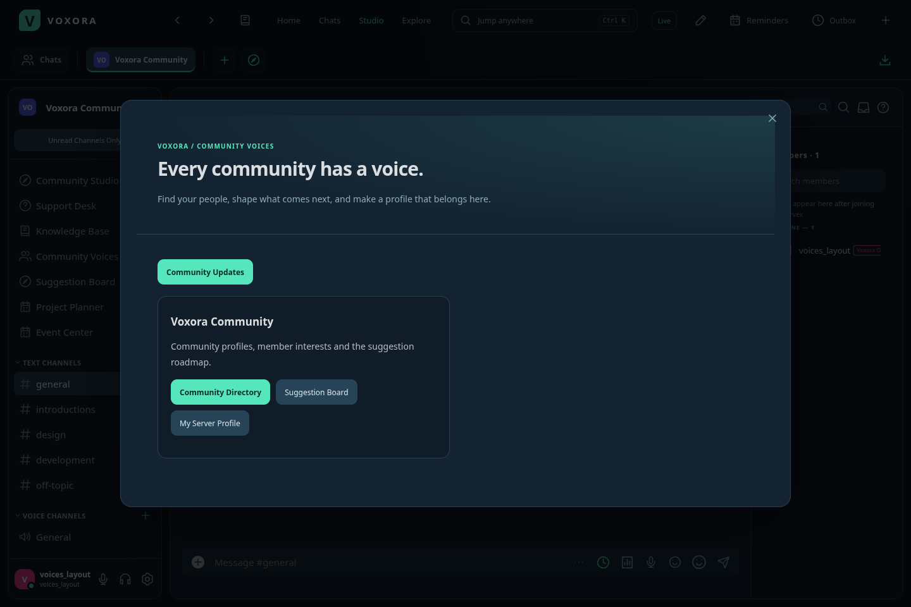
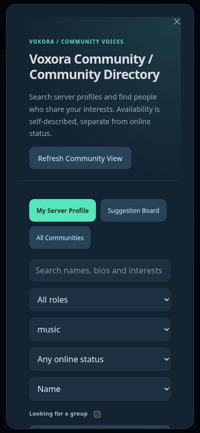
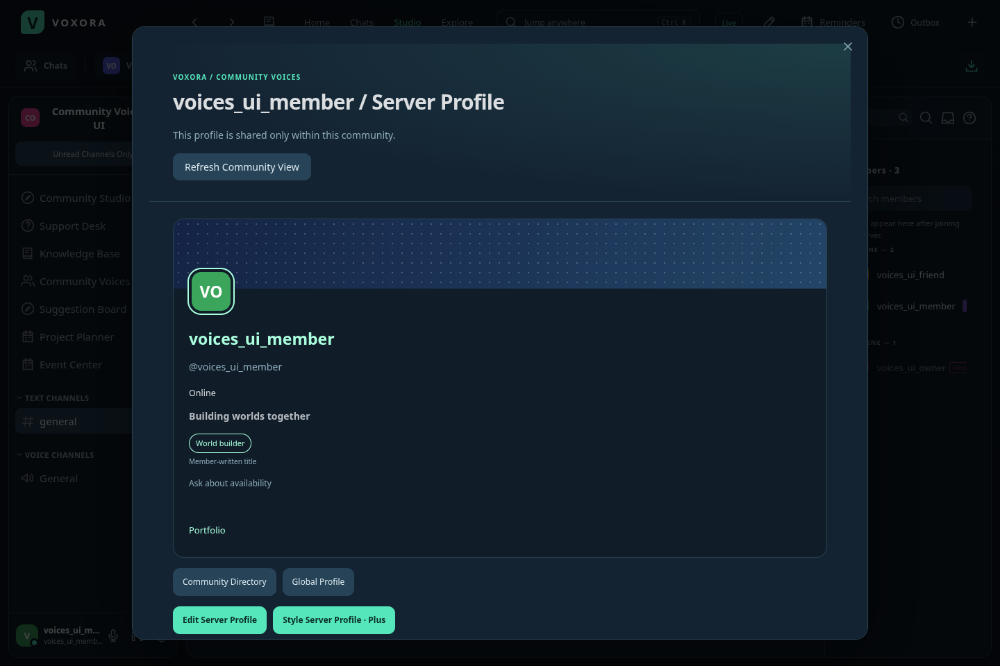
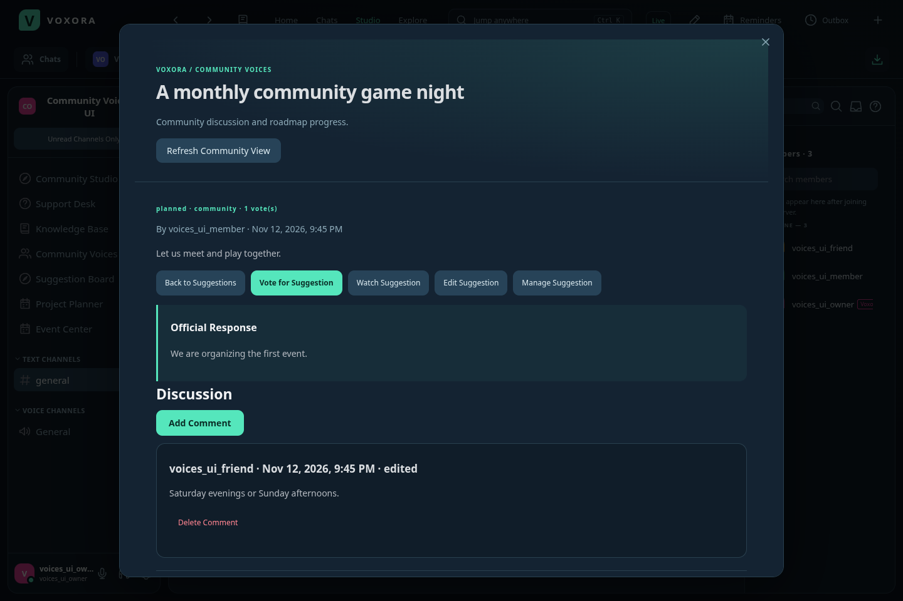
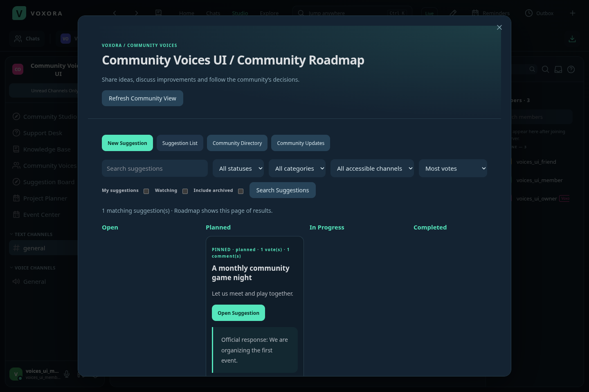

# Voxora 3.7 — Community Voices

Open **Your Tools → Community Voices**, or choose **Community Voices / Suggestion Board** in a server’s sidebar or menu. Home also links to the new tools and your private Community Updates.

## Server profiles and directory

Each server has a separate member introduction. Your global avatar and username remain the account identity; a server profile does not change chat nicknames, staff roles or verification.

- **Server About Me:** up to 1,000 characters for an introduction specific to that community.
- **Server pronouns:** choose a separate optional pronoun field for the server.
- **Interests:** up to eight optional tags, each up to 24 characters. Tags are searchable within the server.
- **Looking for a group:** explicitly opt in to being found by the group-availability filter.
- **Availability:** Ask Me, Open to Connect or Busy Right Now. This is a self-described preference, separate from online presence.
- **Community directory:** search names, usernames, biographies and interests; filter by role, interest, online status and group availability; sort by name or open availability. Results paginate in groups of 30. Invisible accounts continue to appear offline.
- **Profile moderation:** members can reset their own server profile. Manage Nicknames allows resetting a lower-ranked member’s profile, respecting the existing role hierarchy. Resets are audited. Only the member can edit their text or style.

Profiles are available only to active human members of that server. Blocked profiles are hidden from these new endpoints and directory interest suggestions. The global member list and account profile keep their existing behavior. A shared time zone is displayed only when already enabled on the account. Server-specific introductions, interests and group availability are visible to other server members; they are not private notes.

### Six new Plus profile options

1. **Server profile accent** for the name, avatar outline, links and personal title.
2. **Gradient server banner** with two independently chosen colors.
3. **Server-specific headline**, up to 100 characters.
4. **Server profile links**, up to four labeled HTTP/HTTPS addresses.
5. **Banner patterns:** Smooth, Dots, Grid or Diagonal, with an editing preview.
6. **Community title**, up to 40 characters, explicitly labeled as member-written. It does not grant staff status, permissions or verification.

These options require active Plus on the backend. If Plus expires or is revoked, styles fall back immediately to the default appearance; their stored values remain available to the owner for a later renewal. Basic profile fields remain editable. Resetting the profile clears retained styles too. Prices stay US$9.99 monthly or US$89.99 yearly, using the existing Stripe/owner-grant integration.

## Suggestion board and roadmap

Create a suggestion with a title, details, category and a text channel. All suggestions follow that channel’s visibility and posting permissions. Channel placement is fixed after creation to prevent unexpectedly sharing an existing discussion with a new audience.

- **Categories:** Idea, Feature, Bug or Community.
- **Voting:** one vote per account, with explicit add/withdraw actions that remain safe when repeated. Voting does not change a text editor’s revision. Counts include currently eligible members; timeout, onboarding, channel access and blocking can change the count shown to a viewer. Voter identities are not returned.
- **Discussion:** add comments, edit your own comments, and remove your own comments. Suggestion managers and members with Manage Messages can remove other comments in channels they can access. Edits/deletes check revisions.
- **Search and filters:** search titles/details, filter by category, channel, status, your own suggestions or watched suggestions, and optionally include archived entries. Sort by votes, creation time or last update. Results paginate in groups of 30.
- **Community roadmap:** Open, Planned, In Progress, Completed and Declined columns. The roadmap groups the current filtered page, with previous/more controls when needed.
- **Official responses:** suggestion managers publish a response alongside the discussion. Responses are public to people who can view that suggestion.
- **Pinned suggestions:** managers can keep important suggestions first in the current sort.
- **Locks:** stop new comments, edits and votes. Existing voters can withdraw their vote while they still have participation permission.
- **Archives:** remove a suggestion from the default list while preserving its discussion. Authorized members can include archived entries in filters. Managers can reopen it.
- **Watching:** follow discussion edits and roadmap decisions. Authors receive the same private updates automatically. Watcher identities are not returned.
- **Community Updates:** a private inbox retaining up to 100 update references, with mark-read and current-access checks. Losing channel access or blocking the author hides its entries. Votes do not generate updates. This is an in-app inbox, without new background-push promises.
- **History:** inspect the last 50 recorded discussion, edit and decision actions. This is a community-visible history, separate from the server’s staff audit log.
- **AutoMod:** suggestion titles, descriptions, comments and official responses use the channel’s existing AutoMod rules, including edits. Existing rule exemptions still apply.

Create Suggestions and Send Messages are required to create, discuss or vote. Complete onboarding and wait for timeouts/chat restrictions to end before participating. Manage Suggestions is a separate role/channel permission for decisions, pins, locks, archives and moderation of others’ suggestions. The default @everyone role includes Create Suggestions, and existing roles that allow Send Messages receive it on first migration; Manage Suggestions is not automatically granted to ordinary members. Existing administrators have all permissions. Members can delete their own suggestions, including closed ones; managers can delete others’ entries. Deletion is permanent and audited.

Limits: 1,000 suggestions per server, 200 comments and 1,000 watchers per suggestion; five new suggestions per account per hour and 20 comment writes per minute. Creation and comments use request identifiers to prevent accidental duplicates. Saved edits and decisions reject stale revisions. Votes and watching are independent of text/decision revisions.

## Deployment and update

The Windows 3.7 installer is released through the exact-installer verification gate, including a real upgrade from 3.6. Installed clients discover and download the update through the existing feed, then offer **Settings → Updates → Restart and Install**.

For the public service, deploy **main** on Render with **Manual Deploy → Deploy latest commit** or enable Auto-Deploy on commit. The desktop update feed cannot deploy the hosted backend. Reopen clients after deployment. Existing Android/iPhone 3.4 shells load the new hosted screens without replacing those shells.

## API entry points

- `/api/servers/:serverId/voices/profiles` — filtered directory.
- `/api/servers/:serverId/voices/profiles/me` and `/:userId` — member profile reads, own edits and authorized resets.
- `/api/servers/:serverId/voices/suggestions` and `/:suggestionId` — filtered board and entry operations.
- Suggestion `/vote`, `/watch`, `/comments`, `/comments/:commentId` and `/moderation` actions.
- `/api/me/community-updates` — the account’s private update inbox.

New endpoints require an active human session. Raw voter/watcher identifiers, request nonces and retained inactive Plus styles are excluded from other members’ DTOs. Profile and suggestion records stay in the existing persistent workspace state; no new external database or provider credentials are required.
