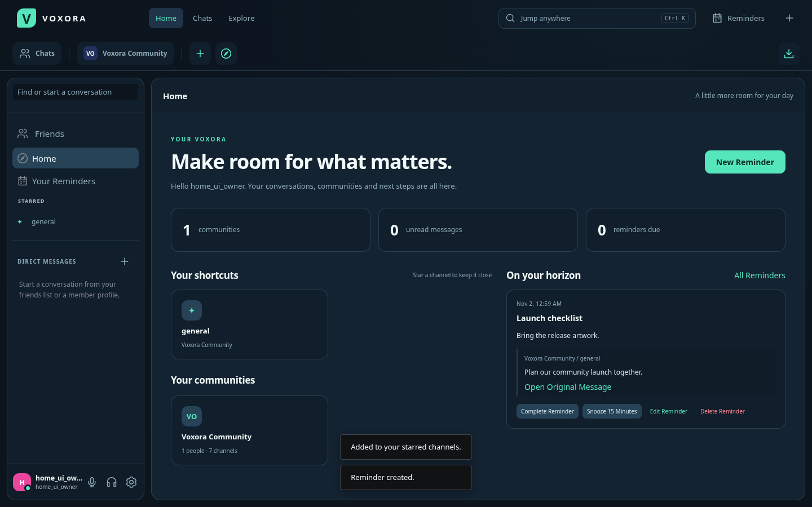
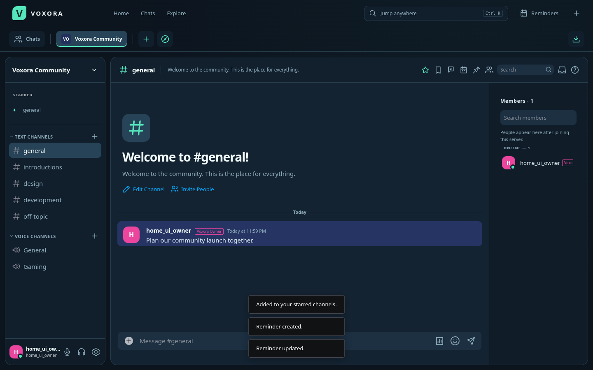
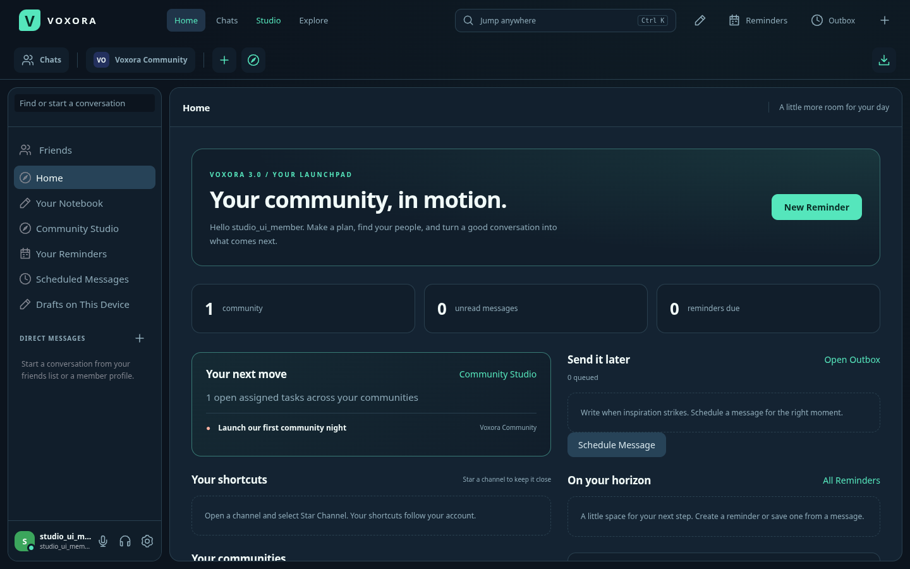

# Home, reminders and shortcuts

Select **Home** in the Voxora navigation bar (or the Voxora wordmark). Your private hub shows community cards, unread totals, starred channels and your next six active reminders. **Reminders** opens the full list, with Active, Completed and All filters and pages of 50 items.

Select **Star Channel** in a channel or direct message header. Stars appear in Home and the sidebar and sync to your other sessions. Select **Unstar Channel** to remove one. Stars disappear while a channel is inaccessible or a direct conversation is blocked. Each account can save 100 unique stars.

Choose **New Reminder**, **Remind Me** in a message menu, or **Remind Me About Reply** on a threaded reply. Give the reminder a title, an optional private note and a local date/time. Quick buttons select five minutes, an hour or tomorrow. Each account can retain 500 active and completed reminders; delete old entries to make room.

Only you can read or change your reminders, including platform staff. Message previews are live references: editing the source changes its preview, and deletion, blocking or lost channel access hides it. Your own title and private note remain. Avoid copying source content into your note if you want it to disappear with the original. **Open Original Message** returns to its channel or thread.

Due reminders stay in Home until you complete or snooze them. Completion moves an item to Completed; Restore makes it active again. Snooze moves it fifteen minutes ahead. Edits use a revision check so a stale device cannot silently overwrite another device's changes. Data persists with your Voxora account on that backend.

While a session is connected, a due reminder produces a generic in-app alert. Sound and desktop notifications respect your device preferences and Do Not Disturb. The alert contains no message or note text. Reminders are not an email or mobile push service; offline due items remain in Home when you return.

**User Settings → Appearance → Accent color** offers Mint, Copper and Iris. Accent color, light/dark theme, compact messages, font size and reduced motion sync with your account and are included in portable appearance exports. Portable appearance exports exclude reminders and stars.

The horizontal community ribbon supports existing server folders, drag/drop, unread badges and context menus. At narrow widths, the channel list is available from its menu button and the ribbon scrolls horizontally. A shared backend must run 2.15 for Home and reminder APIs. Local Workspace stays available without a domain.

[Mobile Home preview](home-mobile.png).

Voxora 3.0 adds **Your next move**, showing your open assigned project tasks across accessible communities, and **Happening in your communities**, showing active giveaways. **Community Studio** opens shared boards and giveaway/insight tools. The private Notebook card opens saved ideas and checklists. See the [3.0 Studio guide](STUDIO.md).

