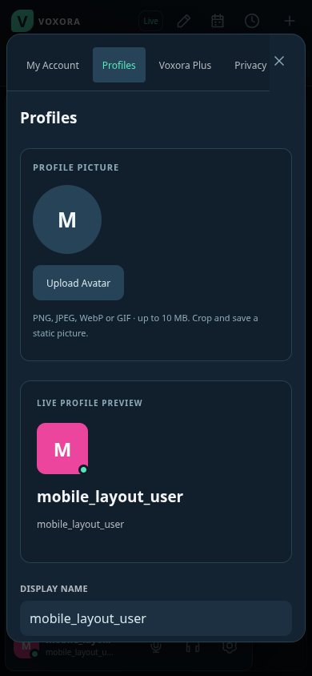
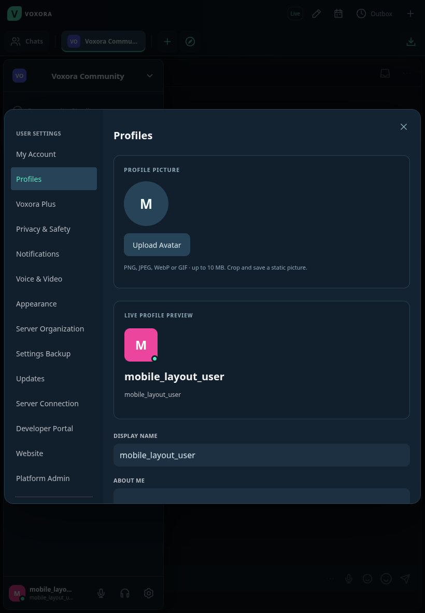
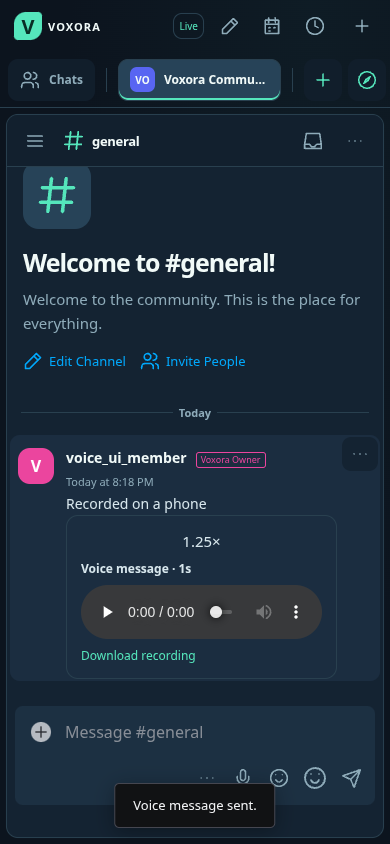

# Voxora 3.4: mobile, voice and sharing

## Phones and tablets

The chat app uses a fixed device-scale viewport, touch gesture guards and fields of at least 16 CSS pixels to prevent pinch/double-tap and iPhone focus zoom inside the app. Native Android/iOS clients explicitly disable webview zoom; the iPhone client also disables viewport bounce. Browser or OS accessibility controls remain outside the application's control.

The workspace follows the visible viewport when the keyboard opens. Chat hides its upper navigation while typing on touch devices to leave more room for messages. Safe areas protect controls around notches and home indicators. Phones have a spacious two-row composer, tappable message menus and a compact channel menu; scheduling, polls, pins, search, events and saved messages remain available through those menus. Channel navigation can be dismissed by tapping outside it. Tablet portrait and landscape layouts use the available room without horizontal page scrolling. Settings use horizontal tabs on phones and a sidebar on tablets.

## Voice messages

Choose **Record Voice Message** in the composer, then **Start Recording**. You can pause/resume, stop and listen before sending, record again, or add a caption. Nothing is uploaded until **Send Voice Message** is selected. The recording UI limits clips to two minutes, and uploads are limited to 8 MB. The microphone stops on close, send or when the app is hidden. Recordings use the input device, noise suppression, echo cancellation and gain settings from Voice & Video when supported.

Messages include an audio player, playback speed control and download link. Playback is authenticated, follows the destination channel's access rules and supports seeking. Captions follow existing message moderation; recording audio is not transcribed or automatically screened. Server roles and channel overrides can restrict **Send Voice Messages**, alongside Send Messages and Attach Files. The permission is added once for existing roles with Attach Files, and current templates preserve deliberate denials.

## Forward messages

Open a message's **More → Forward Message**, or choose **Forward Reply** on a thread reply. Select an accessible destination and confirm sharing. Forwarding copies the text and attachments and labels the original author. Poll votes, command actions and moderation records are not copied. A recipient can retain the copy even if the original disappears. Forwarded copies cannot be edited to alter attribution; delete and forward again instead.

Forwarding checks source and destination access again after copying files, applies destination moderation and plan limits, and does not repeat mentions. External custom emoji and stickers keep their Plus requirements and channel permissions. Forwarding never grants access to the source channel or attachment library.

## Search

Use **Advanced Search** on desktop or **More channel actions → Search Messages** on a phone/tablet. Search text or phrases, authors, attachments and dates. The same filters can be typed into the search field:

- `from:username` and `in:channel-name`
- `has:voice`, `has:image`, `has:video`, `has:file`, `has:link`, `has:poll`
- `after:2026-01-01 before:2027-01-01` (UTC date boundaries)
- `"release notes"` for a phrase

Search includes accessible chat and thread history, excludes blocked authors and never exposes inaccessible channels. Filters combine; repeated authors/channels select any match, and repeated attachment filters require all selected kinds. Results show the newest 100 matches.

## Installing and activating

The Android 3.4.0 APK uses Voxora's existing signing certificate and a higher version code. It can update the earlier APK. The iPhone 3.4.0 IPA is unsigned and still needs signing with AltStore/Sideloadly. Free Apple provisioning and background-notification limits are unchanged; see [mobile installation](MOBILE.md).

Deploy the latest source on Render and reopen web/mobile clients for the new layouts and APIs. Installing an EXE/APK/IPA does not deploy the shared backend. The Windows installer includes the same changes for local workspaces; its update feed remains protected by an exact-download Windows installation and upgrade test.

