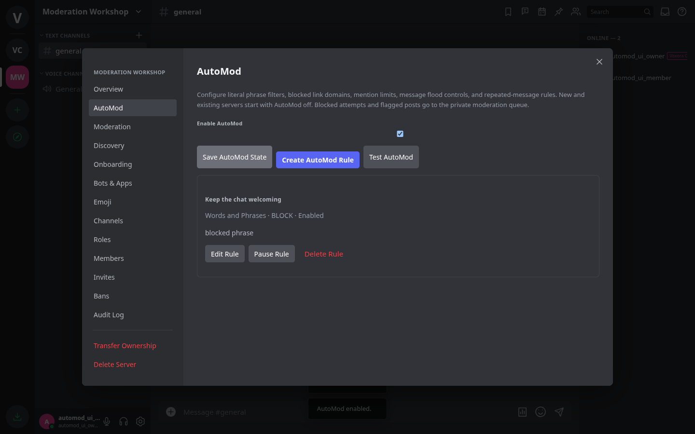
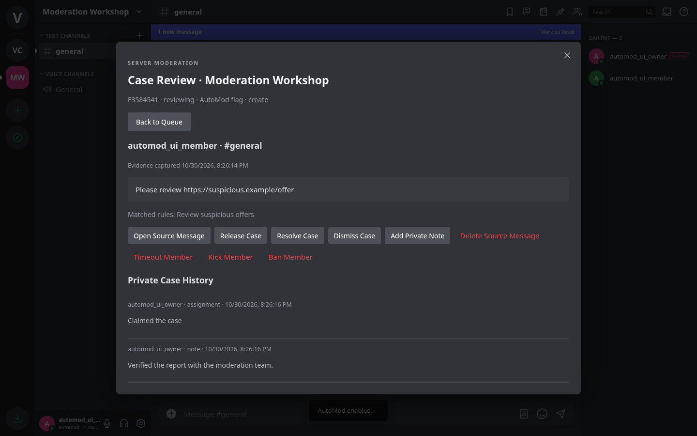

# AutoMod, reports and moderation cases

Voxora 2.10 adds server moderation under **Server Settings → AutoMod** and the server dropdown → **Moderation Queue**. Upgrade a shared backend separately from desktop clients. Existing servers start with AutoMod disabled and no rules; existing staff roles receive no new permissions automatically.

## Configure AutoMod

The server owner, administrators and roles with **Manage AutoMod** can create up to 25 rules, pause individual rules, preview messages, and enable the server's rules. Each rule either **blocks** a message or leaves it visible and **flags** it for staff. If several rules match, any Block rule takes precedence; the case records all matches.

| Rule | Behavior |
| --- | --- |
| Words and Phrases | Up to 50 literal words or phrases. Whole-word boundaries, Unicode normalization, case folding, invisible format-character removal and collapsed whitespace. Regex and wildcards are not interpreted. |
| Blocked Links | Up to 25 domain names, including their subdomains, in explicit HTTP/HTTPS links. A lookalike suffix such as `blocked.example.safe.test` does not match `blocked.example`. International domain names are normalized. |
| Mention Limit | Blocks or flags more than the configured number of distinct other server members mentioned by username. Code blocks and inline code do not count. Role mentions and `@everyone` are not included. |
| Message Flood | Allows the configured count, then matches further posts by the same author in the same channel during the window. |
| Repeated Messages | Allows the configured count of equivalent normalized messages in that channel during the window. Attachment-only messages use their attachment IDs. |

Count limits are 1–20; flood/repetition windows are 5–300 seconds. Main-channel posts and their thread replies share the frequency window. Edits are checked for words, domains and mentions, but do not increase frequency counters. Blocked attempts do not count as accepted posts. Deleting posts or restarting the backend does not clear the saved window; pausing the server's AutoMod does. The bounded recent-post ledger retains up to 5,000 entries for five minutes per server.

Rules apply to human server posts, edits, thread replies and poll questions/answers. Owners, administrators and bot-authored messages are exempt. Choose trusted-role and channel exemptions per rule; an exempt role bypasses its rule even when self-selected through onboarding. AutoMod does not scan DMs, images, attachment contents or third-party pages. It is a literal filter, not a semantic content classifier. Preview ignores administrator/bot immunity and the master switch, respects enabled rules and exemptions, and creates neither messages, counters nor cases.

Blocked creates return HTTP 422 (`automod_blocked`) before allocating a message sequence or changing slowmode. Blocked edits preserve the original message. The sender sees a generic explanation and keeps their draft. Staff receive private evidence in the queue. Configuration changes are audited.

## Member reports

Right-click another author's server message → **Report Message**, or choose **Report Reply** on a thread reply. Select a reason and optional details. Reports require current access to the source; DMs and self-reports are unsupported. Each member can submit five unique reports per server every ten minutes. Retrying a previously submitted report returns the same receipt without using another slot. Different reporters on one open source case can be grouped, up to 20 per case.

**Server dropdown → Your Reports** shows only your submissions, reference, status and whether the source remains available. Reporters cannot see other reporters, staff identities, case evidence, notes or resolution reasons. Reviewers can see reporter identities and details. Losing access to the channel hides the associated receipts.

## Staff workflow and permissions

**Review Reports** opens the queue and permits claiming, private notes, resolving, dismissing and reopening cases. It does not grant access to hidden channels, message deletion, timeouts, kicks or bans. Platform staff roles confer no bypass. Every case lookup, search, dashboard count and update requires current channel access. Live access revocation clears an open case's evidence.

Queue filters include open/reviewing/resolved/dismissed status, case type and channel; search covers author, evidence, reference and private notes. Pagination returns 20 cases. Staff can claim their own case; another active reviewer's claim cannot be taken without administrator authority. Departed or unauthorized assignees can be replaced. Updates carry a workflow `version`; stale staff writes receive 409 rather than overwriting another moderator's changes. Reasons are required when resolving or dismissing. Cases retain their latest 20 private history entries.

Actual enforcement requires the corresponding permission in addition to Review Reports: **Manage Messages** for the source channel, **Timeout Members**, **Kick Members**, or **Ban Members**. Normal hierarchy and owner/administrator timeout protection remain in effect. Actions require a reason and resolve the case. Deleting a parent message also removes its attached thread and replies; deleting a thread reply leaves its parent. Timeouts range from one minute to 28 days through the API. The UI offers one minute through seven days. Moderation actions are audited and rechecked after the full request body arrives.

## Evidence, retention and activity

Reports capture the original text and poll options, author name/ID, attachment filenames and source pointer. AutoMod captures the first matching attempt. File bytes are not duplicated. Subsequent source edits or deletion do not rewrite evidence. **Open Source Message** navigates to a currently accessible original, including a thread reply, when it still exists. A blocked proposed edit can point to the unchanged original message; its case is labeled as an edit.

Repeated AutoMod attempts with the same author, channel/thread, matching rules, action and operation within 60 seconds are counted in one open case. Original evidence and the action target remain fixed. New attempts and additional reporters do not change the staff workflow version, so ongoing traffic cannot prevent triage. A trigger after resolution creates a new case.

Each server retains up to 500 cases. Creating a new case evicts the oldest closed case first; open cases are never silently removed to make room. A full queue rejects new human reports with 429. AutoMod keeps blocking, counts unrecorded incidents, and shows that total to the server owner. Cases for deleted channels are hidden immediately and removed during the next moderation prune. Data is stored privately inside the backend state and is omitted from normal server DTOs, bot DTOs and layout templates. Backend operators with filesystem access can read state, as with chat history.

The dashboard covers the seven UTC calendar days ending today. It counts retained cases and attempts, submitted reports, surviving messages and distinct human authors only in channels the reviewer can currently view. Deleted messages no longer count; evicted cases no longer contribute. These are operational counts, not a permanent analytics archive.

## HTTP API

Human session authentication is required. Base: `/api/servers/:serverId`.

| Route | Purpose |
| --- | --- |
| `GET /automod` | Read visible configuration, exemption roles/channels. |
| `PATCH /automod` | Set `{enabled}`. |
| `POST /automod/rules`, `PATCH /automod/rules/:id`, `DELETE /automod/rules/:id` | Create, update or remove a rule. Kind is immutable after creation. |
| `POST /automod/test` | Pure preview `{channel,text,userId?}`. |
| `POST /reports` | Submit `{messageId,threadId?,reason,details?}`. |
| `GET /reports/mine` | Private reporter receipts. |
| `GET /moderation/cases` | Queue with `status`, `kind`, `channel`, `q`, `offset` filters. |
| `GET /moderation/cases/:id` | Evidence, history and currently available actions. |
| `PATCH /moderation/cases/:id` | `{version,claim? ,note?,status?,resolution?}`. |
| `POST /moderation/cases/:id/action` | `{version,action,reason,durationSeconds?}`; action is `remove-message`, `timeout`, `kick` or `ban`. |
| `GET /moderation/stats` | Channel-filtered counts and seven daily activity buckets. |

Report reasons: `Harassment`, `Spam`, `Harmful content`, `Privacy violation`, `Other`. Rule kinds: `keywords`, `domains`, `mentions`, `spam`, `duplicates`; rule actions: `block`, `flag`. Rule bodies accept `name`, `kind`, `enabled`, `action`, `terms`, `domains`, `limit`, `windowSeconds`, `exemptRoleIds`, `exemptChannelIds`. Limited editors cannot enumerate or remove hidden-channel exemptions by replacing their visible list. Human SSE clients receive a content-free `moderation-update` only when they can currently view the affected channel and review cases or own a report there. Existing bot moderation APIs remain available; this queue/configuration API is for human staff.
