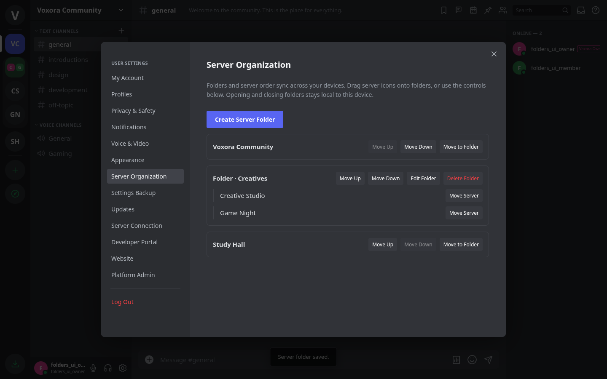
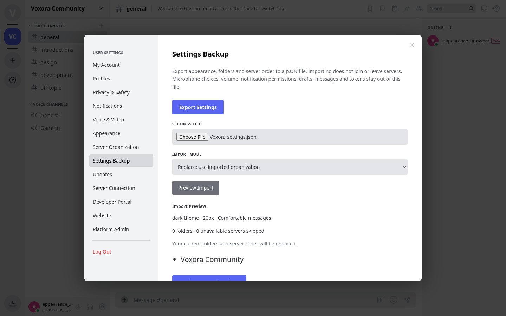

# Personal server folders and settings

Voxora 2.11 adds private server organization and account-synced appearance. Upgrade a shared backend separately from desktop clients to enable these controls there. Folders belong to each account on that backend; they do not change a server's channels, roles or membership.

## Organize your servers

Right-click a server icon → **Create Folder with Server**, or open **User Settings → Server Organization → Create Server Folder**. Choose a name and color. Drag server icons onto a folder, or right-click a server → **Move to Folder**. Drop a server before another server to reorder it; dropping before a server inside a folder places it there. Server Organization has Move Up/Down controls for top-level entries and Move Server controls inside folders, so dragging is optional. Up to 20 folders and 500 explicitly placed servers are supported.

Select a folder to expand it. The folder shows a preview of its first four servers, aggregate unread/mention indicators, and accessible server counts. Right-click it to edit its name/color, mark its servers read, or delete it. Deleting a folder puts its servers back into the list without leaving them. Empty folders remain available. Servers you join appear at the end until you place them; servers you leave or lose membership in disappear from the visible organization and exports.

Folders, their colors, server membership and ordering sync across your sessions. Whether a folder is open or closed stays on the current device, per account. Other members and platform staff cannot inspect your personal folder names through account/server APIs. Normal unread and notification rules still apply to each server/channel.

## Sync appearance

**User Settings → Appearance** synchronizes Dark/Light theme, Compact message display, Chat font size (13–20px), and Reduce animations. System reduced-motion preferences are also respected. The first browser/device to initialize an account's appearance migrates its existing local choices; later devices receive the account's saved appearance. Microphone selection and output volume remain local.

Changes from other sessions apply live. Requests use a version check to avoid overwriting another device's newer settings. Rapid appearance changes from the same device are queued and can advance through that device's successful saves; a competing device still causes a conflict. Folder forms and import previews retain the version they opened with and must be reopened or previewed again after a conflicting change.

## Export and import settings

Open **User Settings → Settings Backup → Export Settings** to download `Voxora-settings.json`. It contains appearance and server organization only. It excludes passwords, cookies, bot tokens, chat/history, saved-message notes, profiles, drafts, voice-device IDs, output volume and notification settings/permissions.

Choose a JSON file, select an import mode, then **Preview Import**. Preview shows the proposed appearance, folders, server list and count of unavailable servers skipped, without saving anything.

- **Merge** preserves saved server placements, folder names and colors. It adds new imported folders, and can group servers that were only in the automatic unplaced list. When the same folder ID exists, eligible new members are appended. Imported appearance replaces current appearance.
- **Replace** uses the imported folders/order and appearance, then appends joined servers missing from the file. It never joins, leaves, deletes or changes a server.

**Apply Imported Settings** performs the change only if settings still match the preview's version. Imports from another backend usually contain unavailable server IDs, which are skipped; appearance still transfers. Unknown fields, unsupported schemas, duplicates, invalid colors/IDs/appearance and excessive folders are rejected before any settings change. Files are limited to 100 KB in the UI and requests to 128 KB. No file content is executed.

## Backend and API

Private state lives in `user.workspace = {version, appearance, layout}`. Existing accounts migrate with `appearance: null` and an empty saved layout; reads materialize only joined servers, appending unplaced ones without mutating state. Each folder is `{kind:'folder', id:UUID, name, color:'#rrggbb', serverIds:[...]}`; a loose server is `{kind:'server', id}`. The bootstrap response includes only the caller's workspace. Public user DTOs, bot DTOs, server templates and other users' bootstraps exclude it. Backend operators with filesystem access can read this state, as with other account data.

All routes require an active human session and are under `/api/me/workspace`:

| Method/path | Purpose |
| --- | --- |
| `GET` (base) | Current version, appearance and membership-filtered layout. |
| `PATCH` (base) | `{version, appearance?, layout?}`; appearance is a complete four-field object. Missing joined servers are appended in the next view. |
| `GET /export` | `{format:'voxora-settings', schema:1, exportedAt, appearance, layout}`. |
| `POST /import-preview` | `{settings, mode:'merge'|'replace'}` → current version, proposed appearance/layout, ignoredServers. No save or event. |
| `POST /import` | `{version, settings, mode}` → saved workspace plus ignoredServers. |

Stale versions return 409. Direct placement of unjoined servers returns 403; unavailable imported IDs are skipped. Membership and suspension are checked after the complete body arrives. Every successful mutation saves before notifying only the account's SSE sessions with `{type:'workspace-update'}`. No private content travels in the notification. The regular bootstrap refresh handles live appearance and membership changes. Account-specific local caches and generation checks keep queued work from crossing a logout/account switch.
