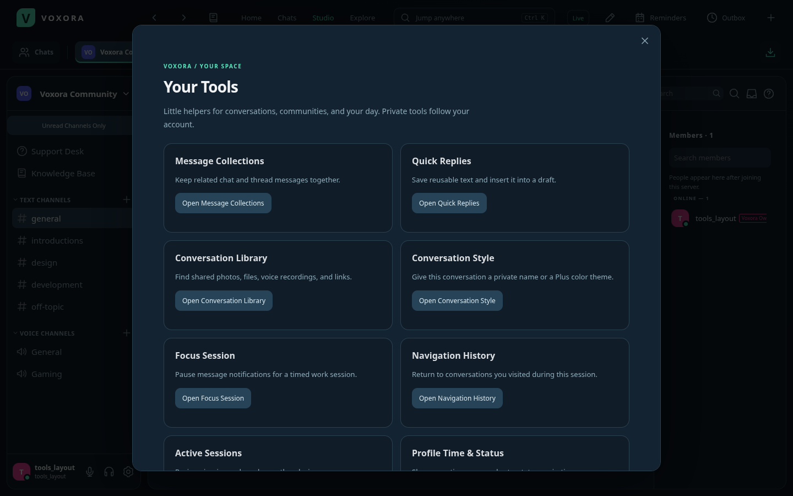
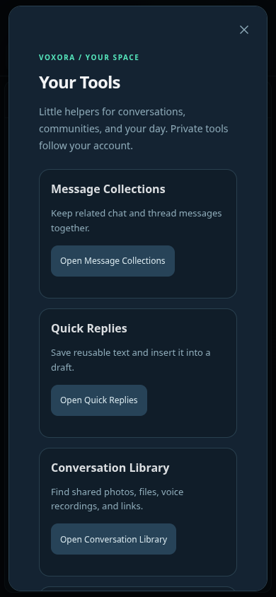

# Voxora 3.5 — Your Space

Open **Your Tools** from the book button in the top bar, the Chats sidebar, or User Settings. Message and composer menus offer shortcuts to the tools for the current conversation.

## 18 additions for everyone

1. **Message collections:** create, rename and delete private collections; collect chat messages or thread replies, open originals, and remove individual references. Each account can keep 30 collections of 200 messages. Deleted, blocked or inaccessible originals are hidden.
2. **Quick replies:** keep up to 100 reusable text replies, edit them, and insert them into the current draft. Inserting never sends a message.
3. **Conversation media library:** browse shared images, videos, files and voice recordings, including accessible thread replies. Search filenames/message text, paginate and return to the original message.
4. **Conversation link library:** find HTTP/HTTPS links in accessible chat and threads, search their accompanying text and open their original messages. Links are not fetched or unfurled by the server.
5. **Private conversation aliases:** give a channel or DM a name only you see. Aliases sync with the account and never rename the server's actual channel.
6. **Private member notes:** open a profile's Private Note action to keep up to 2,000 characters about that person. Notes belong only to their writer and are never included in public profile data.
7. **Shared profile time zones:** optionally choose an IANA time zone in Profile Time & Status. Other people can see your local time when opening your profile. Sharing defaults off.
8. **Expiring custom statuses:** clear a status after one hour, four hours, one day or seven days. Expiration does not alter online status.
9. **Active session management:** review sign-ins, revoke a selected session or sign out every other device. Revocation ends its live chat/call connection, authentication and background-push subscription. Authentication hashes/tokens are not returned in the session list.
10. **Timed focus sessions:** pause message, mention and reminder alerts for 15, 25, 50 or 90 minutes across the account, or end the session early. Unread history and online status remain available.
11. **Recurring reminders:** repeat a private reminder every 24 hours or seven days. Completing it advances the same reminder to its next future occurrence. These are fixed intervals; they do not promise a fixed local clock time across daylight-saving changes.
12. **Composer formatting toolbar:** apply bold, italic, underline, strike, spoiler and inline code to the selected draft text. Open it from More message options.
13. **Live message preview:** edit draft text while previewing its formatting, then return it to the composer without sending.
14. **Localized message timestamps:** insert a date/time, full date, short time or relative time using `<t:UNIX_SECONDS:STYLE>`. Readers see the instant in their own device time zone; relative timestamps update while the app is open.
15. **Read aloud:** explicitly read a message or thread reply using the device's speech API. Leaving the conversation, signing out or selecting Stop in Your Tools cancels speech. Voice availability depends on the browser/device; Voxora does not upload text to a transcription service.
16. **Unread channel filtering:** show unread channels plus the current channel in the server sidebar. The preference syncs across devices and can be switched off at any time.
17. **Conversation navigation history:** use Back/Forward on desktop or Navigation History in Your Tools to return to a recent destination. The last 50 destinations stay in memory for the signed-in session, clear on logout and are checked against current access.
18. **Curated server resources:** members with Manage Channels can create, edit and remove up to 100 community links with descriptions. Resources can be visible to all server members or limited to people who can view a chosen channel.

## 8 new Voxora Plus features

1. **Conversation color themes:** save a two-color background per conversation, synchronized with the account.
2. **Custom message sounds:** choose Classic, Bell, Arcade, Soft or Orbit for eligible in-app message pings. This changes sounds played by Voxora while running; operating-system background push sounds remain controlled by the system.
3. **Dynamic quick replies:** expand `{{username}}`, `{{date}}`, `{{time}}` and `{{channel}}` when inserting a reply. Dates/times use your shared time zone or UTC when unset. Normal sending limits and moderation still apply.
4. **Saved searches:** name and rerun up to 30 search queries, including author, channel, attachment and date filters. Execution uses current channel access and block rules.
5. **Markdown collection export:** download available collection text, author attribution, dates and attachment names. It does not embed private attachment bytes or grant access to originals.
6. **Cloud draft shelf:** explicitly save a text snapshot for a conversation and restore it on another device. Up to 100 snapshots are supported, one per conversation. Saving checks revisions to prevent stale overwrites. Drafts and attachments are not uploaded automatically.
7. **Profile style presets:** save up to 12 named combinations of banner colors, accent and badge visibility, then apply one without re-entering its colors.
8. **Extended voice messages:** record up to five minutes and 25 MB, compared with two minutes and 8 MB on Free. New uploads, sends, thread replies and forwards check the current plan. Previously published clips remain playable by authorized recipients.

Creating/applying Plus styles, saving cloud drafts/searches/presets, expanding dynamic replies, exporting collections and recording extended clips require active Plus on the backend. Repeated form submissions cannot grant access. When Plus expires, themes and message sounds fall back automatically; owned text, presets and draft snapshots are retained. Existing drafts can still be read/deleted, and saved queries/presets can be inspected/deleted without an active plan.

## Deployment and updates

Deploy **main** on Render using **Manual Deploy → Deploy latest commit**, or enable Auto-Deploy on commit. Reopen the app after deployment. Desktop publishing and the Windows update feed do not deploy the public backend.

The existing Android/iPhone 3.4 native shells load these hosted features once the backend is deployed; this release does not require replacing those shells. Windows 3.5 includes the same tools for local workspaces. Its automatic-update feed is published only after the exact downloadable installer passes Windows install, relaunch, upgrade and data-preservation checks.

Prices remain **US$9.99/month or US$89.99/year**, using the existing Stripe integration and owner-granted access. This update adds no payment-provider credentials to the source or downloads.

## API entry points

- `/api/me/toolbox`, `/api/me/focus`, `/api/me/sessions`
- `/api/me/collections`, `/api/me/snippets`, `/api/me/user-notes/:userId`
- `/api/me/channel-tools/:channelId`, `/api/channels/:channelId/library`
- `/api/me/saved-searches`, `/api/me/cloud-drafts`, `/api/me/profile-presets`
- `/api/servers/:serverId/resources`

All endpoints require an authenticated, active human account. Private tools notify only their owner. Resource mutations require Manage Channels. Item updates and destructive collection/resource/library mutations use revisions; source access is rechecked before presenting message content. Session revocation is deliberately limited to the current account's other sessions.
