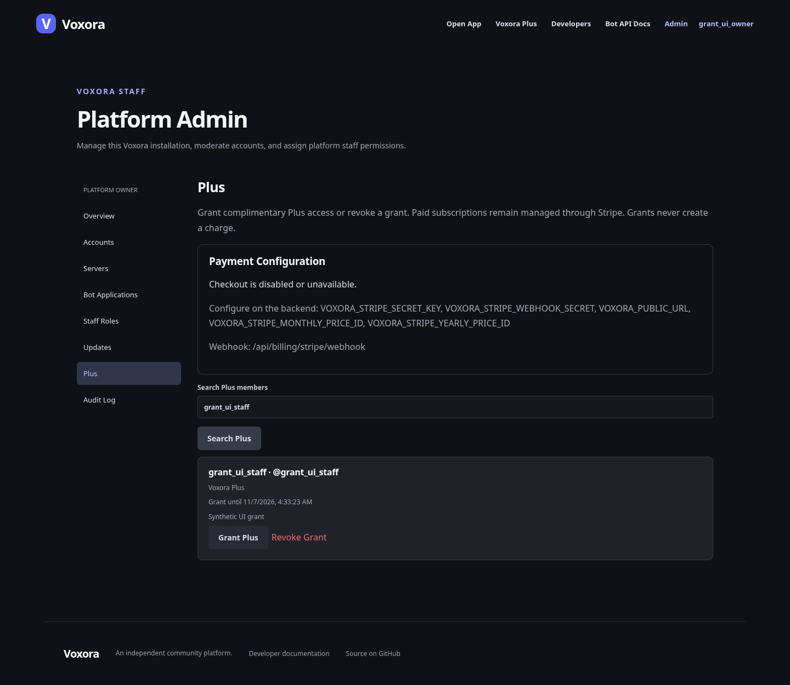
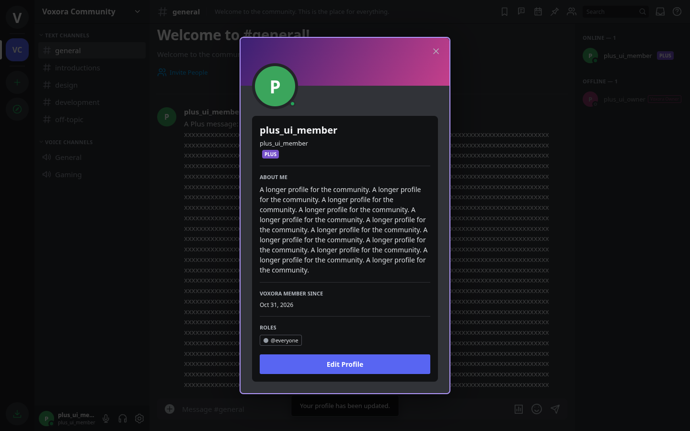

# Voxora Plus

Voxora 2.12 adds **Voxora Plus at US$9.99/month or US$89.99/year**, with Stripe subscriptions. The yearly plan saves US$29.89 compared with twelve monthly payments. Plans belong to an account on the Voxora backend where it registered. A subscription on one independently hosted backend does not grant access on another.

Open **User Settings → Voxora Plus**, or visit `/plus` on the main website. The plan screen shows current access, billing status, profile controls and boost slots. The first-account platform owner can grant complimentary access immediately; real purchases remain disabled until Stripe is configured. The installer contains no payment credentials and does not create a Stripe merchant account.

| Perk | Free | Plus |
| --- | --- | --- |
| Attachment size | 8 MB | 25 MB |
| Message and thread reply length | 2,000 characters | 4,000 characters |
| Profile bio | 190 characters | 500 characters |
| Gradient profile banner and accent | — | Included |
| Optional Plus badge | — | Included |
| Server boost slots | — | Two |
| Core chat, calls, roles and bot support | Included | Included |

Upload sizes use 1,048,576 bytes per MB. Limits apply to human accounts; bots retain their existing limits. Plus never overrides server membership, private-channel permissions, role hierarchy, slowmode, rules screening or moderation. AutoMod inspects the full premium message and poll options. Revoking/expiring access applies the lower limits to new writes, including requests whose bodies are still arriving. Existing messages, attachments and emoji remain available through their normal access checks. A longer stored bio falls back to a 190-character public view when Plus ends; the stored value and profile style are retained for a later renewal.

## Grant access without taking a payment

1. Sign in as the first-account platform owner and open **Platform Admin → Plus**.
2. Search for a username, select **Grant Plus**, choose 1, 7, 30, 90 or 365 days, or ongoing access, and enter a reason.
3. Select **Grant Plus Access**. The member's app receives the updated perks live.

**Revoke Grant** removes complimentary access. It does not cancel a paid subscription; a valid paid subscription can independently keep Plus active. Ordinary platform staff, account moderators, server owners and server administrators cannot issue grants. Grant actions are version-checked and audited; reasons are visible to the platform owner and authorized platform audit readers, and stay out of member/public account views.



## Profile styles and boosts

With Plus active, choose **Customize Plus Profile** for gradient colors, an accent and the optional badge. The ordinary Profiles screen accepts the longer bio. Style fields cannot activate a subscription or change staff permissions.



Assign both boost slots to one server or support two servers you belong to. Two active boosts unlock **100 custom emoji slots** instead of 50. Manage Emoji is still required to upload. Removing a boost is immediate; moving its slot to a different server has a 24-hour cooldown. Restoring the same server is allowed. Expiration, suspension or leaving a server stops the boost's contribution. Existing over-cap emoji are retained and usable, while new uploads above the current limit are refused.

## Connect Stripe

Use a shared backend reachable over HTTPS so Stripe can deliver signed webhooks to the same installation that owns the accounts. Upgrading a desktop app does not deploy or configure that hosted backend. Use a separate data directory for billing tests. Keep secret keys on the backend, never in a bot, renderer, Git commit or chat message.

1. Copy [.env.example](../.env.example) to a private `.env` on the backend. Set `VOXORA_PUBLIC_URL` to its actual HTTPS origin, without a path. Start with a Stripe **test-mode secret key** in `VOXORA_STRIPE_SECRET_KEY`.
2. Create/reuse the exact product and prices with:

   ```sh
   node --env-file=.env build/stripe-setup.mjs
   ```

   Alternatively, set the key in the process environment and run **`npm run billing:setup`**. This creates/reuses the `voxora_plus` product and recurring USD prices of 999 cents monthly and 8999 cents yearly. It never charges a customer and never prints the secret key. Copy the returned non-secret IDs into `VOXORA_STRIPE_MONTHLY_PRICE_ID` and `VOXORA_STRIPE_YEARLY_PRICE_ID`. Existing mismatched products/lookup keys are refused instead of overwritten. You can also create matching recurring prices in the Stripe Dashboard and configure their IDs directly.

3. In Stripe, add a **snapshot webhook endpoint** at:

   ```text
   https://YOUR-BACKEND/api/billing/stripe/webhook
   ```

   Enable `checkout.session.completed`, `customer.subscription.created`, `customer.subscription.updated`, `customer.subscription.deleted`, `invoice.paid`, and `invoice.payment_failed`. Put this endpoint's signing secret in `VOXORA_STRIPE_WEBHOOK_SECRET`.
4. Enable the Stripe **customer billing portal**, including cancellation and payment-method/invoice management. If plan changes are enabled there, restrict them to these two approved Plus prices and quantity one. Returning from the portal uses `VOXORA_PUBLIC_URL`.
5. Start or restart the backend using its configured environment, for example **`node --env-file=.env server.js`**. `npm start` uses existing process environment variables; it does not automatically load `.env`. Preserve the existing data directory, port, host, ICE/TURN and service settings when updating a deployed server.
6. Open **Platform Admin → Plus** to check configuration, then test checkout, webhook confirmation, portal access and cancellation. After that, configure the live-mode key, live price IDs and live endpoint signing secret on the production backend. Test and live Stripe catalog objects are separate.

Required variables are `VOXORA_PUBLIC_URL`, `VOXORA_STRIPE_SECRET_KEY`, `VOXORA_STRIPE_WEBHOOK_SECRET`, `VOXORA_STRIPE_MONTHLY_PRICE_ID`, and `VOXORA_STRIPE_YEARLY_PRICE_ID`. Outbound HTTPS to `api.stripe.com` must work. Public non-loopback origins require HTTPS; HTTP localhost/127.0.0.1 is allowed for development with webhook forwarding. No arbitrary request host or client-supplied price, customer ID, quantity or return URL is accepted as checkout configuration.

The service checks that Stripe prices are active, fixed recurring USD prices matching the published amounts and intervals before allowing checkout. Test mode is labeled in the UI. Switching test/live mode keeps separate saved billing bindings and does not turn a test subscription into live paid access. Prefer separate test and production data directories and Stripe accounts; do not switch a live backend to a different Stripe merchant account while retaining old customer bindings.

## Checkout, renewal and cancellation

Subscribe Monthly/Yearly creates a hosted checkout and shows **Continue to Stripe Checkout**. Card details stay with Stripe. Repeated clicks reuse the pending checkout; changing intervals requires canceling that pending checkout first. **Manage Billing** opens the bound account's Stripe portal through a generated link.

A success URL alone never activates Plus. Signed webhooks fetch canonical subscription state from Stripe inside a per-account queue before updating access. Active/trialing subscriptions qualify only until the confirmed period end; other statuses do not. Canceling at period end preserves perks until that timestamp. Past-due/unpaid subscriptions lose paid access and can be repaired through the portal. Complimentary grants remain a separate source of access. Suspending an account pauses its perks; it does not cancel or refund its Stripe subscription. The operator handles billing adjustments in Stripe.

If confirmation is delayed, select **Refresh Billing Status**. The server checks its saved checkout/subscription with Stripe and verifies customer and user metadata before granting access. An expired saved checkout is reconciled before another one is created, preventing a paid session with delayed webhooks from silently producing a second subscription. Invalid signatures, replayed events, stale payloads, unsupported products, mismatched accounts and unsafe checkout/portal redirects cannot activate access. Last-confirmed paid access survives a temporary provider outage until its saved period end. Provider problems leave the existing app running and offer a retry.

## Storage, privacy and API

State lives in private `user.premium` records plus a bounded `state.premiumBilling.events` list (last 1,000 processed event IDs). Customer/subscription IDs, pending URLs and saved test/live bindings never appear in public user/server/bot DTOs, settings exports, templates or source archives. Public profile views expose only the optional badge and currently active style. The member's own plan endpoint exposes status, expiry, limits and boost choices, without raw Stripe identifiers or grant reasons. Backend operators with filesystem access can read private state, as with other application data. Back up that data directory when upgrading; it contains the subscription-to-account bindings needed to process future events.

| Endpoint | Access/purpose |
| --- | --- |
| `GET /api/premium/catalog` | Public USD pricing and checkout availability. |
| `GET /api/premium/me` | Current member's private plan, limits, style and boosts. |
| `PATCH /api/premium/profile` | `{version,bannerStart?,bannerEnd?,accent?,showBadge?}`; active Plus required. |
| `PATCH /api/premium/boosts/:slot` | `{version,serverId}`; slot 1/2, null removes, active Plus and current membership required to assign. |
| `POST /api/premium/checkout` | `{interval:'month'|'year'}`; returns a verified Stripe URL. |
| `POST /api/premium/checkout/cancel` | Expires the unfinished checkout; never cancels a paid subscription. |
| `POST /api/premium/portal` | Generates the member's private billing portal link. |
| `POST /api/premium/sync` | Reconciles saved billing state with Stripe. |
| `POST /api/billing/stripe/webhook` | Public route authenticated by a timestamped HMAC signature over the raw body. |
| `GET /api/platform/premium/configuration` | Platform owner only; configuration status/names, no secret values. |
| `GET /api/platform/premium/members` | Platform owner only; search `q`, pagination `offset`, 25 members/page. |
| `PATCH /api/platform/premium/members/:id` | `{version,days,reason}` or `{version,revoke:true,reason}`; platform owner only. |

Testing uses isolated accounts and a local Stripe mock. No real payment was taken, and live Stripe checkout/webhook behavior still needs verification with the operator's configured account.
