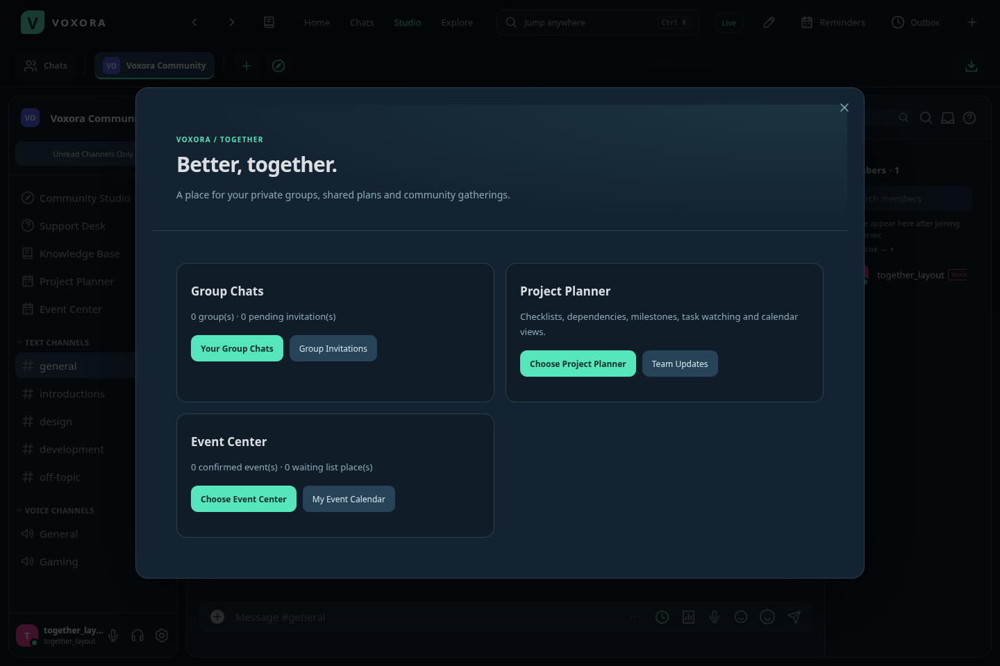
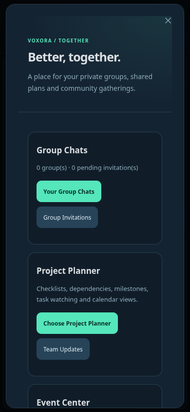
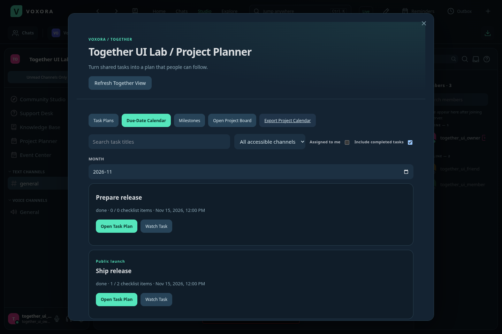
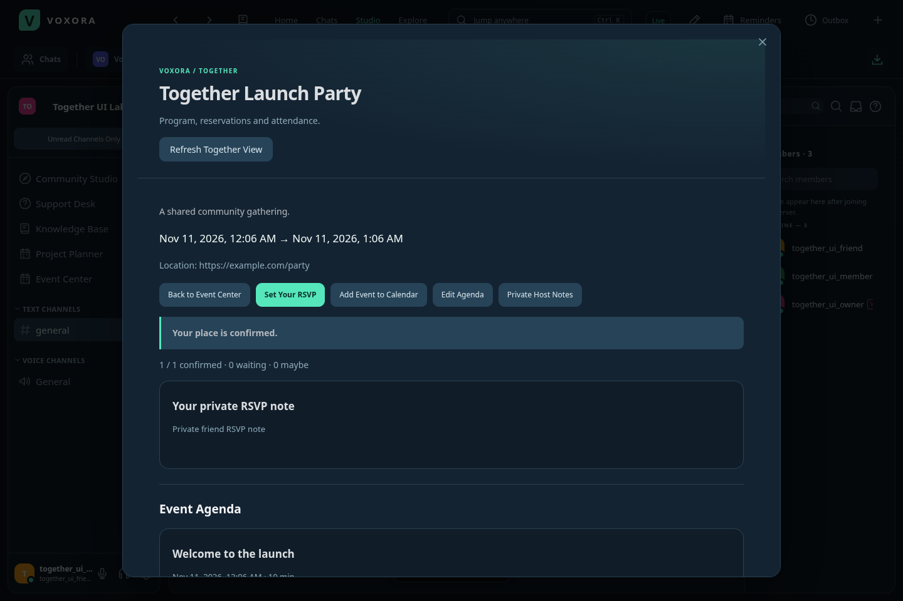

# Voxora 3.6 — Together

Together brings private group conversations, shared project planning and event attendance into Voxora. Open **Your Tools → Together**, use **Open Together** on Home, or choose **Project Planner / Event Center** in a server's sidebar or menu.

## Private group chats

Create a named group with a topic and color. Choose initial invitees, or invite people later from Group Details. The group owner controls invitations, names, membership and ownership transfer. Free owners support **10 members** and Plus owners support **20 members**. If Plus ends, existing members keep access; new joins wait until the group fits the current limit.

Invitations go to a person's account and expire after seven days. Invitees see the group and participant names, then explicitly confirm joining and gaining access to its existing history. Declining and owner cancellation are supported. An invitation does not reserve a place, and it does not grant history or attachment access before acceptance. Invitations are limited to friends/shared-server contacts without blocked participants.

Group chats use the existing composer, attachments, voice messages, polls, reactions, personal mentions, search, read state, mute settings and notifications. A separate one-to-one DM remains a separate conversation. Group history begins as read when someone joins, so old messages do not become hundreds of new unread alerts.

Members can leave. The owner can remove another member or transfer ownership to an active current member. Owners transfer ownership before leaving other people behind. Leaving/removal immediately revokes API, file and live conversation access; existing messages remain in workspace storage for remaining members. Blocks can pause messaging and alerts for affected participants in an existing group. The owner can resolve membership from Group Details.

There are limits of 30 owned groups, five creations per hour and 30 pending invitations per group. The owner can cancel a pending invitation and resend if needed.

## Project Planner

Open the existing Project Board to create tasks, then choose **Open Task Plan** from a task or use the server's Project Planner.

- **Shared checklists:** keep up to 30 items per task. Creators and project managers edit checklist text; assignees can tick items. Tick progress appears on the planner and original board.
- **Dependencies:** select up to 15 prerequisite tasks in the same server. Cycles and self-dependencies are rejected. Completing a task requires all its prerequisites to be done. Dependencies must be visible to the editor and current assignee; assigning someone who cannot read them is rejected.
- **Blocked-work indicators:** tasks show when prerequisites are unfinished or unavailable. A deleted prerequisite remains an unavailable blocker until an authorized editor removes it.
- **Milestones:** project managers create channel-scoped milestones with descriptions, dates and open/completed status. Tasks can be assigned to an open milestone in their own channel. Progress updates from linked task status. Complete all linked work before completing a milestone, and unassign tasks before deleting it.
- **Task watching:** follow a task independently of being its creator or assignee. Watcher identities are private. Changes appear in the creator/assignee/watchers' Team Updates, excluding the actor and people who have lost access.
- **Team Updates inbox:** inspect and mark private updates read from Together or Home. Up to 100 update references are retained per account, and inaccessible source tasks are hidden when read.
- **Task activity:** the most recent 50 planning changes show actor, action and time.
- **Due-date calendar:** browse tasks by month, search, channel and assignee, optionally including completed tasks.
- **Calendar export:** download task and milestone due dates as an ICS calendar. Exports include only currently accessible content and escape/fold calendar fields safely.

Existing Send Messages and Manage Projects permissions apply. Creators and project managers edit planning details; assignees can change task status and tick checklist items. Milestone management requires Manage Projects and Send Messages. Planning updates use revisions to prevent stale saves from replacing another person's changes. Editors close when their channel access is revoked.

Tasks retain their own status control: checking checklist items does not automatically finish a task. Milestones share a channel's visibility. Private prerequisite titles and watcher identities are omitted from views that cannot access them, including scoped bot task responses.

## Event Center

Existing events now have an attendance and planning center. Schedule an event with the usual event form, then open its plan in Event Center.

- **Going / Maybe / Not Going / Clear response:** record a response separately from the older Interested toggle. Use Going in Event Center to reserve a place.
- **Capacity:** event managers choose unlimited attendance or 1–10,000 places.
- **Ordered waitlists:** Going responses keep their original request order. Repeatedly saving Going does not move someone forward. A full event can place new responses on its waitlist, or reject them when the waitlist is disabled.
- **Automatic place calculation:** places are recalculated from current eligible Going responses. Declines, membership/access changes, timeouts and capacity changes can change confirmations and waitlist positions. Returning eligibility retains the original request order. Onboarding and timeout restrictions apply to participation.
- **Co-hosts:** managers appoint up to ten active participants. Co-hosts can edit the program, read host/RSVP notes and check people in; capacity and co-host changes still require Manage Events.
- **Ordered agendas:** create up to 30 segments with descriptions, duration and optional speakers. Reorder segments and see their calculated local start/end times. The program must fit within the event, including after a date/duration edit.
- **Private RSVP notes:** participants can share up to 500 characters with event managers/co-hosts. Other attendees cannot read these notes.
- **Private host notes:** keep up to 4,000 characters for active event hosts. Host-only editors close if the user loses the relevant access.
- **Attendance roster and check-in:** members see confirmed attendee names; hosts see responses and private notes. During active/completed events, hosts can manually check in a confirmed attendee or clear a check-in. This is a staff action, without location tracking.
- **Personal event calendar:** export currently confirmed upcoming events into one ICS file. Private RSVP and host notes are excluded.
- **Event duplication:** prefill a fresh event with public details and a new time. Attendees, reservations, check-ins, co-host notes and agendas are not copied into the new event.
- **My RSVP / waitlist filters:** narrow the event list to Going responses or waiting places. Home summarizes confirmed events and waitlist status.

Event visibility follows the server's existing event rules: external events are visible to server members; voice events follow voice-channel access. Attendance and host privileges are rechecked on every action. Read state, status and notification preferences continue to control chat alerts.

## Updating

Windows 3.6 is published through the exact-installer verification gate. Installed clients discover and download the release through the existing feed; choose **Settings → Updates → Restart and Install**.

This release also fixes the unread-filter header overlapping Community Studio, preserves selected task statuses during live refresh, and adds Notebook to Your Tools for compact phone navigation.

Deploy **main** on Render using **Manual Deploy → Deploy latest commit**, then reopen clients to activate the hosted UI and APIs. The desktop installer cannot deploy Render. Existing Android/iPhone 3.4 shells load this hosted update without a new APK/IPA.

All existing Plus features remain available at the configured $9.99 monthly / $89.99 yearly prices. Group size is determined by the current owner's active plan. This update does not create a charge or change a subscription automatically.

## New API entry points

- `/api/groups`, `/api/groups/:id`, membership/leave/invitation subroutes
- `/api/group-invites` and recipient-only accept/decline actions
- `/api/servers/:id/planning`, milestone/task-plan/calendar subroutes
- `/api/me/planning-updates`
- `/api/servers/:id/event-center` and event settings/RSVP/agenda/check-in subroutes
- `/api/me/event-calendar`

These new mutation endpoints require an active human session. Existing scoped Studio bot APIs keep working, including the added task summary fields, while respecting their channel scopes.
